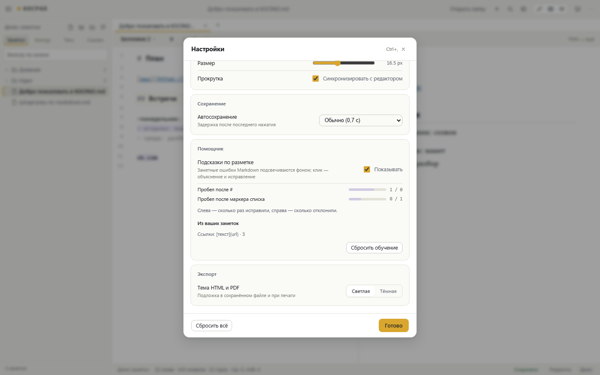

<div align="center">
  
  <h1>KOCPAD · Experimental</h1>
  <p><b>A branch for things that are not ready for beta yet.</b></p>

  [](https://github.com/ShiDikALexey/KOCPAD/actions/workflows/build.yml)
  [](https://github.com/ShiDikALexey/KOCPAD/tree/beta)

  <sub><a href="README.md">Русский</a> · English · <a href="https://github.com/ShiDikALexey/KOCPAD/blob/main/README.en.md">full description (main)</a></sub>
</div>

---

The inline assistant from this branch shipped in stable `1.5.1`. The branch is now
the base for the next ideas: style hints (M3) and whatever comes after. New
experiments do not reach `main` or `beta` until you decide they are ready.

The notepad notices places where the markdown is probably broken and tints them. A
click opens a short explanation and three buttons: fix, ignore, never suggest again.

## What it looks like

You type `##Привет`. Half a second later `##Привет` gets a lavender background.
Click it and you get: "a space after `#` is required, otherwise this is not a
heading", the example `## Привет`, and a fix button. The fix is a normal edit, so
`Ctrl+Z` reverts it.


There are sixteen rules: space after `#`, more than six `#`, skipped heading level,
bare URL, unclosed link, link without a protocol, missing space after a list marker,
mixed list markers, unclosed code fence, unclosed inline code, unclosed `[[link]]`,
a tag glued to a word, missing blank line before a block, double blank line,
trailing space, double space.

Rules stay quiet inside code blocks. Only the background is tinted, at most five
suggestions at a time. If Windows has "reduce motion" enabled, the fade is skipped.
The assistant does not use the network and does not download anything. It is
switched on in settings under "Помощник".

## Learning panel

Settings → "Помощник" shows what the assistant has learned: how many suggestions
per rule were fixed or ignored, how confident each rule is, and how you usually
format links, lists and quotes. The same place has a "reset learning" button.



Confidence affects the order of suggestions: rules you accept more often are shown
first. A rule stays neutral until it has at least three decisions.

## What to try

- `##Привет`, `-пункт`, `1)пункт`, `vk.com` get tinted and explained;
- unclosed `` `code ``, `[[Note` and ``` ``` ``` are found;
- nothing is tinted inside a code block;
- "ignore" hides a hint until the app restarts;
- "never suggest" keeps a rule off after a restart;
- switching the assistant off removes every tint at once;
- after a fix the settings counter goes up, and "reset learning" clears it;
- typing in a 5,000-line note does not slow down.

The branch runs 59 e2e tests, six of them for the assistant, plus typecheck, the
build, the Windows installer and a launch of the packaged `.exe` in CI.

## What comes next

The learning panel is done. Next are style hints: long sentences and repeats, off by
default.

The idea of a tiny local model for explanations and rewrites is on hold. First we
need to see whether the two steps above are useful at all.

Details and rules: [docs/ASSISTANT.md](docs/ASSISTANT.md).

## Building

Actions → the latest `Experimental` run → the `kocpad-windows` artifact. It has the
portable `kocpad.exe` and the NSIS installer.

Or locally:

```powershell
git checkout Experimental
npm ci
npm run tauri:dev
```

No releases are cut from this branch; finished work merges into `beta`/`main` and
ships from there.

## Other branches

- [main](https://github.com/ShiDikALexey/KOCPAD/blob/main/README.en.md) — stable `1.4.0`, full description.
- [beta](https://github.com/ShiDikALexey/KOCPAD/blob/beta/README.en.md) — `1.5.0-beta.4`, what changed and what is being tested.
