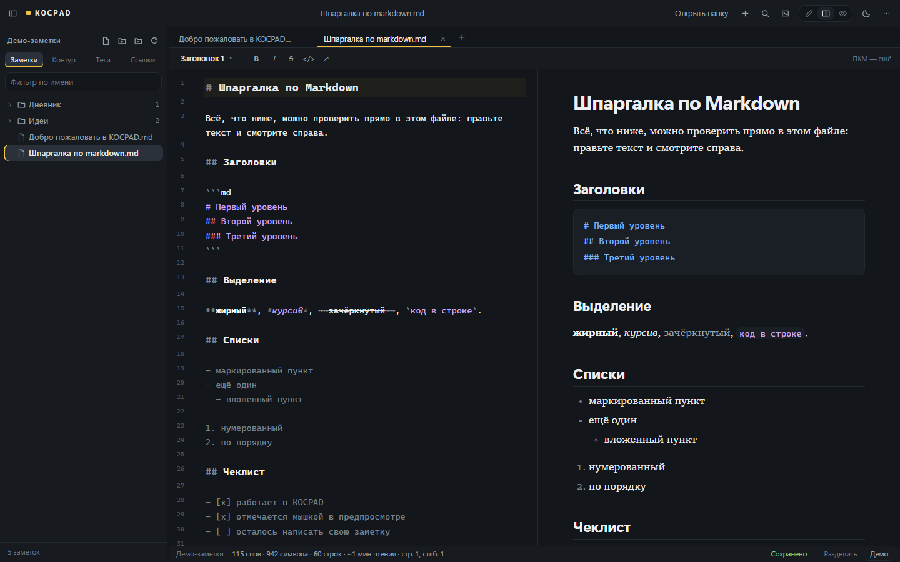
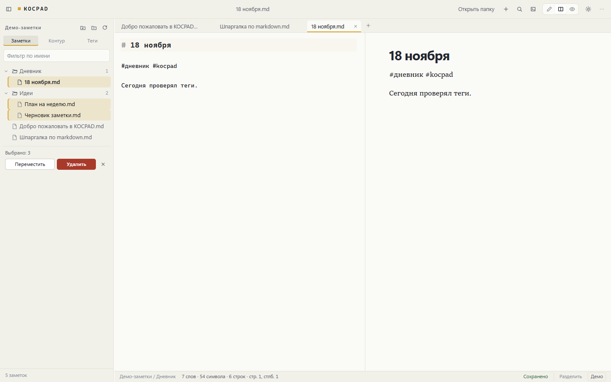
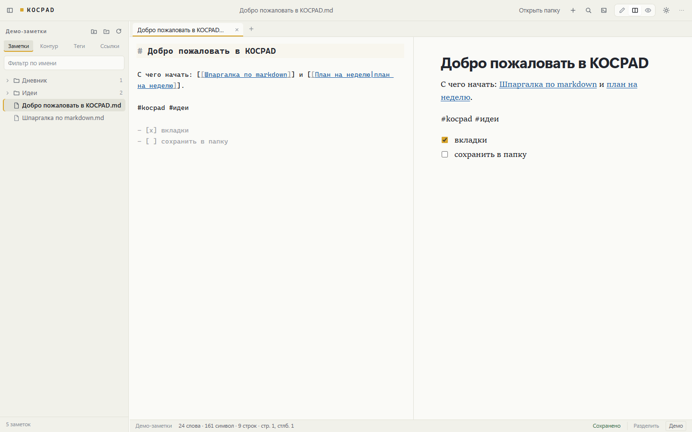
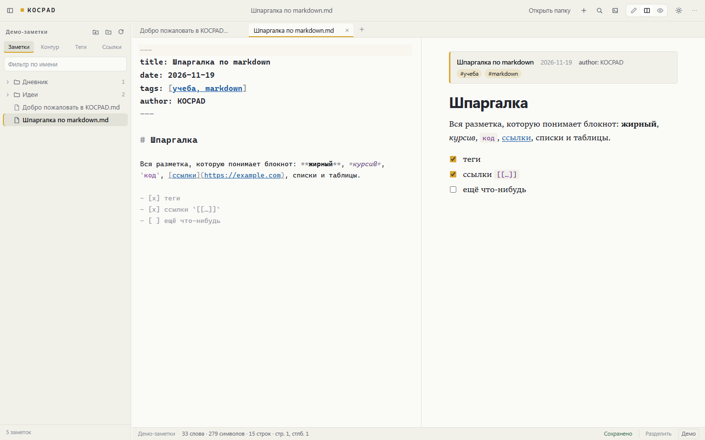
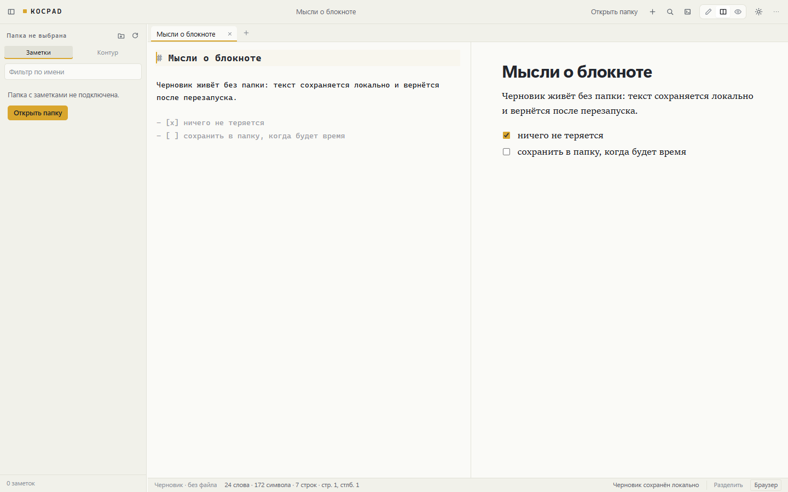

# KOCPAD

[Русский](README.md) · **English**

[](https://github.com/ShiDikALexey/KOCPAD/actions/workflows/build.yml)
[](LICENSE)

**A markdown notepad for Windows — like Notepad, but it remembers everything.**

KOCPAD opens instantly, lets you write immediately (no folder required), autosaves
to disk as you type and shows the rendered result next to the source. Notes are
plain `.md` files: no accounts, no database, no proprietary format — they open in
any other editor.

> Status: **`1.0.0`** — first stable release. Notes, tags, links, drafts, search,
> export and closing without data loss all work; 11 automated UI tests run in CI on
> every push. What is left is external: installer signing (needs a certificate) and
> a clean-machine check. Plan: [docs/ROADMAP.md](docs/ROADMAP.md), history:
> [CHANGELOG.md](CHANGELOG.md).
>
> Download: [installers from the latest release](https://github.com/ShiDikALexey/KOCPAD/releases/latest)
> or the `kocpad-windows` artifact of the [latest build](https://github.com/ShiDikALexey/KOCPAD/actions/workflows/build.yml).


## Download and install

Builds are attached to the [latest release](https://github.com/ShiDikALexey/KOCPAD/releases/latest).
Windows 10 or 11 (x64) and WebView2 are required — the latter ships with Windows 11.

| File | What it is |
| --- | --- |
| `KOCPAD_<version>_x64-setup.exe` | per-user installer (NSIS) — recommended |
| `KOCPAD_<version>_x64_en-US.msi` | MSI for group policy or Intune deployment |
| `kocpad.exe` | portable: drop it in any folder and run, no installation |

The builds are **not code-signed**, so SmartScreen shows "Windows protected your
PC" on first launch: **More info** → **Run anyway**. CI already has a signing step;
only the certificate is missing ([docs/ROADMAP.md](docs/ROADMAP.md)). The installer
is per-user and needs no administrator rights.

Every release also ships `SHA256SUMS.txt`, so a download can be verified:

```powershell
Get-FileHash .\KOCPAD_1.0.0_x64-setup.exe -Algorithm SHA256
# compare with the matching line in SHA256SUMS.txt
```

## What's new in 1.0

- **Quick capture.** `Ctrl+Alt+N` works from any application: the window comes
  forward and starts a new note immediately.
- **Front matter.** A leading `---` block (`title`, `date`, `tags`, any `key: value`)
  is shown as a compact metadata card, and its tags join the tags panel.
- **Export theme.** Settings → «Экспорт»: light or dark background for saved HTML
  and print/PDF output.
- **Scale.** Note text is cached after the first read, so search, tags and links no
  longer re-read the folder each time; large folders render in 150-row chunks with
  «Показать ещё».
- **Automated tests.** 11 Playwright scenarios cover workspace, editor, tags, links,
  front matter, settings and drafts — and run in CI.
- **`[[note]]` links.** Autocomplete after `[[`, clickable links in the preview and
  a «Связи» panel: what links to this note and where it links to. Aliases work:
  `[[Note|custom text]]`.
- **Tags `#tag`.** A «Теги» sidebar panel: every tag with a note count and the
  list of notes that use it. Code blocks are not treated as tags.
- **Bulk actions.** `Ctrl+Click` and `Shift+Click` select several notes, then
  «Переместить» moves them into another folder or «Удалить» deletes them at once.
- **Drafts without a folder.** `Ctrl+N` opens a blank page instantly: the text is
  kept locally and comes back after a restart, and «Сохранить в папку…» turns the
  draft into a real `.md` file.
- **Closing without losses.** On exit KOCPAD asks whether to save drafts into a
  folder, keep them as drafts, or delete them.
- **Window and folder memory.** Window size and position, the last folder, open
  tabs and a recent-folders list in the palette are all restored.
- **One-step onboarding.** On the first launch: «Начать с черновика» or
  «Открыть папку заметок».
- **Settings that fit.** Tab width (2/4/8), Vim keymap, fonts and sizes, five
  accents, autosave delay.
- **Fully Russian interface**, including the find & replace panel.


## Why another markdown editor

- **Local-first.** A folder of `.md` files is the whole storage format. Back it up
  with OneDrive, Git, or a USB stick — nothing is locked in.
- **Notepad speed, editor comfort.** Tabs with independent undo history, markdown
  syntax highlighting, find and replace, live preview.
- **Nothing is lost.** Autosave on every pause, drafts and tabs return after a
  restart, and closing asks about unsaved work.
- **Honest desktop app.** Tauri 2: a small native window using the system WebView2,
  not a browser tab pretending to be an app.

## Features

| Area | What works today |
| --- | --- |
| Notes | Folder of `.md` / `.markdown` / `.mdown` / `.txt` files, tree sidebar, create / rename / delete folders and notes, filter by name |
| Tags | Inline `#tag` and `#work/project`: a «Теги» panel with counts and per-tag note lists; tags inside code blocks are ignored |
| Links | `[[note]]` and `[[note\|custom text]]`: autocomplete after `[[`, a click in the preview opens the note, and the «Связи» panel lists outgoing and backlinks. Missing targets get a dashed underline |
| Front matter | A `---` block with `title`, `date`, `tags` and any `key: value`: metadata card in the preview, tags land in the tags panel |
| Quick capture | Global `Ctrl+Alt+N` from any application: window to the front, new note |
| Scale | Cached note text for search, tags and links; folders render in 150-row chunks and the filter caps at 300 results with a hint |
| Bulk actions | `Ctrl+Click` adds a note to the selection, `Shift+Click` takes a range, `Esc` clears it. «Переместить» into any workspace folder, or «Удалить» the whole batch |
| Drafts | A new note (`Ctrl+N`) appears immediately and needs no folder: the text is stored locally and restored after a restart. «Сохранить в папку…» (`Ctrl+S`) turns it into a real `.md` file, `F2` renames it |
| Closing | On exit: save drafts into a folder, keep them as drafts, or delete them. If the page stops responding, the window still closes |
| Workspace | Open a folder, close it, connect another one; the last folder is remembered, recent folders live in the palette (`Ctrl+K`), open tabs are restored |
| Window | Window size and position are remembered between launches |
| Writing | CodeMirror 6 editor, markdown highlighting, soft wrap, per-tab undo history, `Ctrl+B` / `Ctrl+I`, tab width (2/4/8), Vim keymap |
| Preview | Live GFM: headings, tables, task lists, highlighted code, quotes, links; synchronized scrolling |
| Structure | Outline panel with every heading of the current note, click to jump, current section highlighted |
| Images | Paste or drop an image: it is written to `assets/` next to the note, markdown is inserted, relative images render in the preview |
| Saving | Debounced autosave (0.3 s / 0.7 s / 1.5 s, configurable), explicit `Ctrl+S`, flush on tab switch, blur and close |
| Search | In-note find & replace (`Ctrl+F`, `Ctrl+H`) with a Russian panel, workspace search with snippets (`Ctrl+Shift+F`); drafts are searched too |
| Interface | Light / dark / follow-Windows themes, five accents, configurable editor and preview fonts, editor / split / preview modes, draggable panels |
| Files in | Drag `.md` or `.txt` files from Explorer into the window: imported into the current folder and opened |
| Commands | Command palette (`Ctrl+K`) over every action, settings screen (`Ctrl+,`) |
| Export | Standalone HTML file in a light or dark theme, print-to-PDF through the system dialog |
| Tasks | Click a checkbox in the preview to toggle `- [ ]` in the source |

## Quick start

### Browser preview (no Rust needed)

```bash
npm install
npm run dev          # http://localhost:1420
```

Open `http://localhost:1420/?demo=1` for a self-contained demo workspace that needs
no folder permission. In Chromium, «Открыть папку» connects a real folder through
the File System Access API.

### Desktop app (Windows)

Requirements:

- [Node.js](https://nodejs.org/) 20+
- [Rust](https://rustup.rs/) stable with the MSVC toolchain
- Visual Studio Build Tools with the **Desktop development with C++** workload
- [WebView2 runtime](https://developer.microsoft.com/microsoft-edge/webview2/) —
  preinstalled on Windows 11 and up-to-date Windows 10

```bash
npm install
npm run tauri:dev      # dev window with hot reload
npm run tauri:build    # installers in src-tauri/target/release/bundle
```

The release build produces an NSIS installer and an MSI under
`src-tauri/target/release/bundle/`, plus the portable exe in
`src-tauri/target/release/kocpad.exe`.

> Nothing is installed system-wide by KOCPAD itself: the NSIS bundle uses per-user
> install mode.

### Checks

```bash
npm run typecheck      # TypeScript, no emit
npm run build          # typecheck + production frontend build
npm run test:e2e       # 11 Playwright scenarios (starts the dev server itself)
```

## Keyboard shortcuts

| Keys | Action |
| --- | --- |
| `Ctrl+N` | New note (created immediately, no name dialog) |
| `Ctrl+Alt+N` | Quick capture: global, works even when the KOCPAD window is in the background |
| `Ctrl+Shift+N` | New folder |
| `Ctrl+O` | Open folder |
| `Ctrl+S` | Save now (for a draft: «Сохранить в папку…») |
| `Ctrl+W` | Close tab |
| `Ctrl+Tab` / `Ctrl+Shift+Tab` | Next / previous tab |
| `Ctrl+F` | Find in note |
| `Ctrl+H` | Find and replace |
| `Ctrl+Shift+F` | Search the whole workspace |
| `Ctrl+K` | Command palette |
| `Ctrl+,` | Settings |
| `Ctrl+Shift+O` | Outline panel |
| `Ctrl+E` | Cycle editor → split → preview |
| `Ctrl+B` / `Ctrl+I` | Bold / italic |
| `Ctrl+P` | Print (save as PDF) |
| `Ctrl+Shift+E` | Export to HTML |
| `Ctrl+Shift+L` | Toggle dark theme |
| `Ctrl+\` | Toggle sidebar |
| `Ctrl+=` / `Ctrl+-` / `Ctrl+0` | Editor font size |
| `F2` | Rename the current note or draft |
| `F5` | Refresh the tree |

Full list with context (and the Vim section): [docs/KEYBINDINGS.md](docs/KEYBINDINGS.md).

In the notes tree: `Ctrl+Click` adds a note to the selection, `Shift+Click` takes a
range, `Esc` clears the selection.

Note links: type `[[` and pick a title from the list; `Enter` inserts the title and
the closing brackets.

## Screenshots

| Light | Dark |
| --- | --- |
|  |  |

| Workspace search | Outline panel |
| --- | --- |
|  |  |

| Tags panel | Bulk actions |
| --- | --- |
|  |  |

| Links panel | Wiki links in the preview |
| --- | --- |
|  |  |

| Front matter | Settings |
| --- | --- |
|  |  |

| First launch | Draft without a folder |
| --- | --- |
|  |  |

## How it is built

```
KOCPAD
├─ index.html            app shell (static markup, filled by src/main.ts)
├─ src/
│  ├─ main.ts            wiring: theme, layout, shortcuts, autosave
│  ├─ store.ts           single source of truth: settings, tree, tabs, saves
│  ├─ drafts.ts          untitled notes kept in localStorage
│  ├─ tags.ts            inline #tag parser (code blocks excluded)
│  ├─ wikilinks.ts       [[note]] parser and preview decoration
│  ├─ frontmatter.ts     --- block parser and metadata card
│  ├─ images.ts          pasted images → assets/, relative images → blob URLs
│  ├─ storage/           three backends behind one interface
│  │  ├─ tauri.ts        native build → Rust commands
│  │  ├─ browser.ts      File System Access API + IndexedDB handle
│  │  └─ demo.ts         in-memory sample workspace
│  ├─ editor.ts          CodeMirror 6 wrapper, per-document EditorState
│  ├─ markdown.ts        GFM render, sanitizing, syntax highlight, print/export
│  ├─ ui/                tree, outline, tags, links, tabs, status bar, dialogs,
│  │                     folder picker, palette, search, settings
│  ├─ path.ts, util.ts   path and DOM helpers
│  └─ style.css          design tokens, themes, accents, components
├─ scripts/              bump-version.cjs — keeps the three version fields in sync
├─ tests/                11 Playwright UI scenarios (smoke suite)
├─ src-tauri/            Tauri 2 shell
│  ├─ src/fs_ops.rs      list / read / write / rename / delete / reveal
│  ├─ src/lib.rs         window, geometry memory, close interception
│  ├─ tauri.conf.json    window, CSP, bundle config
│  └─ capabilities/      dialog permissions for the main window
└─ docs/                 architecture, keybindings, roadmap
```

Design decisions worth knowing:

- **The storage interface is the seam.** UI code never touches `fs`; swapping a
  backend (or adding WebDAV later) touches one file.
- **Documents own their editor state.** Each tab keeps a CodeMirror `EditorState`,
  so undo history and caret survive tab switches.
- **Writes are serialized per path.** Autosave and explicit saves cannot interleave;
  a snapshot is only marked clean after it reached the disk.
- **A draft is a document without a file.** `draft:<id>` lives in the same tab list
  as files but writes to localStorage instead of the disk.
- **The Rust side is small on purpose.** Thirteen commands, no plugin scopes to
  maintain, one place that decides which files count as notes.

More detail: [docs/ARCHITECTURE.md](docs/ARCHITECTURE.md).

## Roadmap

Near-term: sign the installer (needs an OV/EV certificate — the CI step is ready)
and verify it on a clean machine. The post-1.0 backlog holds two notes side by
side, optional workspace encryption and a mobile build. The full list is in
[docs/ROADMAP.md](docs/ROADMAP.md), the history in [CHANGELOG.md](CHANGELOG.md),
all builds in [Releases](https://github.com/ShiDikALexey/KOCPAD/releases).

## Contributing

Issues and pull requests are welcome. Read [CONTRIBUTING.md](CONTRIBUTING.md)
first — it is short: run the typecheck, keep the UI strings and README Russian and
the code English, and do not add a framework without a discussion.

## License

[MIT](LICENSE) © KOCPAD contributors
