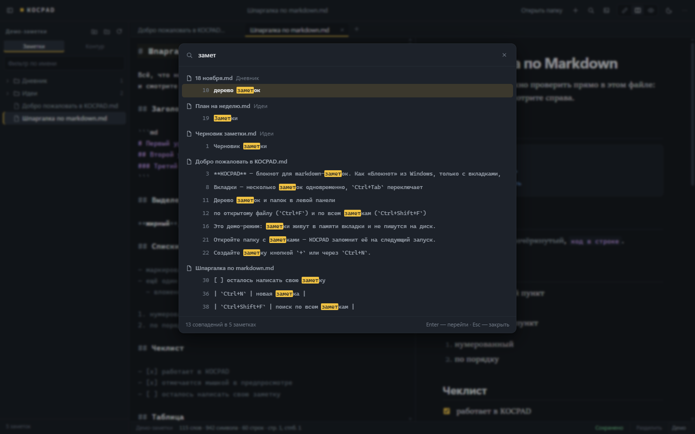
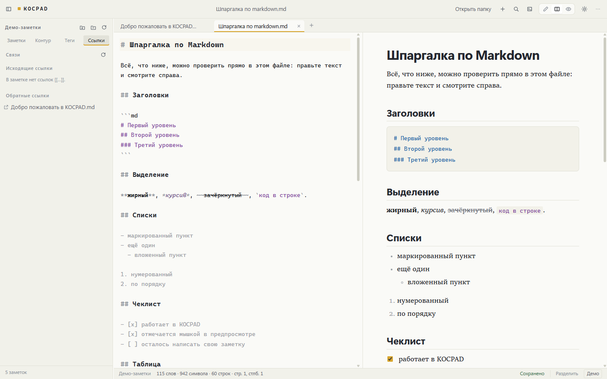
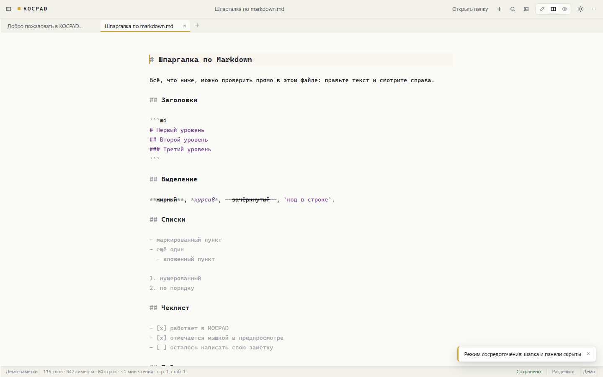
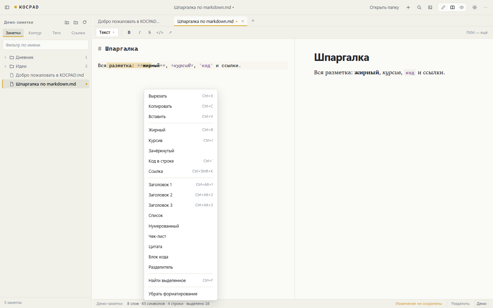

<div align="center">
  
  <h1>KOCPAD</h1>
  <p><b>A markdown notepad for Windows — like Notepad, but it never loses a thing.</b></p>

  [](https://github.com/ShiDikALexey/KOCPAD/actions/workflows/build.yml)
  [](https://github.com/ShiDikALexey/KOCPAD/releases/latest)
  [](#requirements)
  [](LICENSE)

  <sub><a href="README.md">Русский</a> · English</sub>
</div>

---

**KOCPAD** opens instantly and lets you write right away — even without picking a
folder. Text is saved as you type, and the rendered result sits next to it. Notes are
plain `.md` files: no accounts, no database, no proprietary format — they open in any
other editor.

> **Status:** `1.4.0` — the stable release; this file is the full description of
> every feature. 27 UI tests run in CI on every push. Auto-updates are active: the
> signing key is already configured in CI
> ([details](docs/PUBLISHING.md#5-auto-updates)). Installer signing is still blocked
> on a certificate — see [the roadmap](docs/ROADMAP.md).
>
> **Download:** [latest release](https://github.com/ShiDikALexey/KOCPAD/releases/latest) —
> `.exe` installer, `.msi` package, portable `kocpad.exe` and `SHA256SUMS.txt`.

### Branches

| Branch | What lives there |
|---|---|
| `main` | the stable release; full feature description — this file |
| `beta` | the next version (`1.5.0-beta.4`): only what changed and what is being tested — [branch README](https://github.com/ShiDikALexey/KOCPAD/blob/beta/README.en.md) |
| `Experimental` | the inline markup assistant: new features and plans — [branch README](https://github.com/ShiDikALexey/KOCPAD/blob/Experimental/README.en.md) |

New features and fixes land on `beta` first, get tested, and only then merge into
`main`.


## Contents

- [What it is](#what-it-is)
- [How it differs](#how-it-differs)
- [Features](#features)
- [Installation](#installation)
- [First launch](#first-launch)
- [Where data lives](#where-data-lives)
- [Keyboard shortcuts](#keyboard-shortcuts)
- [Screenshots](#screenshots)
- [Building from source](#building-from-source)
- [Tests and CI](#tests-and-ci)
- [How it is built](#how-it-is-built)
- [Documentation](#documentation)
- [Limitations and plans](#limitations-and-plans)
- [FAQ](#faq)
- [Contributing](#contributing)
- [License](#license)

## What it is

KOCPAD is a notes editor for Windows built around one idea: open, write, close —
without losing anything. Tabs, autosave, live preview, tags and links exist to stay
out of the way, not to show off.

The philosophy:

- **Files, not a database.** The workspace is a folder of `.md` files. Sync it with
  anything (OneDrive, Dropbox, git), open it in Obsidian, VS Code or on a phone.
  Removing KOCPAD leaves the notes untouched.
- **Local and account-free.** No sign-up, no cloud, no telemetry, no network calls
  "just in case". The app reaches the network only when you click an external link.
- **Writing first.** No plugin marketplace — only what writing and finding notes
  requires.

## How it differs

| | KOCPAD | Windows Notepad | Obsidian | Joplin |
|---|---|---|---|---|
| Storage | plain `.md` in your folder | `.txt` | its own vault | database + sync |
| Markdown and preview | yes, GFM, live | no | yes | yes |
| Tabs and autosave | yes | no | yes | yes |
| Tags and `[[…]]` links | yes | no | yes | partly |
| Account / internet required | no | no | no | for sync |
| Plugins and themes | none (by design) | none | yes | yes |
| Startup and footprint | instant, small | instant | depends on vault | depends on database |

KOCPAD is not a replacement for Obsidian as a "second brain" nor for Joplin as a
sync tool. It is a fast notepad that is pleasant to write in and never loses text.

## Features

### Notes and files

| Feature | How it works |
|---|---|
| Notes folder | Tree of `.md` / `.markdown` / `.mdown` / `.txt` in the sidebar, filter by name |
| Notes and folders | Create, rename (`F2`), delete, context menus, drag `.md` files into the window |
| Tabs | Several notes at once, `Ctrl+Tab` switches, `Ctrl+W` closes; each tab keeps its own undo history |
| Autosave | Writes as you type (delay configurable), `Ctrl+S` saves at once; atomic write via a temp file |
| Drafts | `Ctrl+N` opens a blank page immediately, even without a folder; text lives locally and returns after a restart |
| Bulk actions | `Ctrl+Click` and `Shift+Click` in the tree: move a batch into another folder or delete it with one confirmation |

### Writing and markup

| Feature | How it works |
|---|---|
| Markdown highlighting | CodeMirror 6: headings, lists, links, code, tables |
| Live preview | Right-hand pane with synced scrolling; editor / split / preview modes |
| Line breaks | "Like Notepad" (default): every line starts a new line; or "Like Markdown": lines join into a paragraph |
| Line numbers | Faint but always visible (on by default); can be turned off in settings or the «⋯» menu |
| GFM | Tables, task lists, strikethrough, autolinks, footnotes |
| Formatting | `Ctrl+B` bold, `Ctrl+I` italic, ``Ctrl+` `` code, `Ctrl+Shift+K` link; pressing again removes the markers |
| Block-type bar | The field above the editor shows the current block and converts it: text, headings 1–3, bullet, ordered, task list, quote, code block, separator |
| Context menu | Right click in the text: cut/copy/paste, inline formatting, block conversion, find the selection, strip markup |
| Front matter | A leading `---` block with `title`, `date`, `tags` and any `key: value` is shown as a metadata card |
| Focus mode | `Ctrl+Shift+Z`: one narrow text column, no panels or preview; `Esc` exits |
| Vim | Optional keymap (`hjkl`, modes), loaded on demand from settings |
| Tab width | 2, 4 or 8 spaces, global |

### Search, tags and links

| Feature | How it works |
|---|---|
| Find in note | `Ctrl+F`: find and replace, case, regexp, whole word |
| Workspace search | `Ctrl+Shift+F`: every note with context, grouped by file, jump to line |
| Tags | Inline `#tag` and `#work/project`; a «Теги» panel with counts and note lists; front-matter tags included |
| Wiki links | `[[note]]` autocomplete, clickable links in the preview, a «Связи» panel with backlinks; aliases `[[Note\|text]]` |
| Outline | All headings with click-to-jump and an active-section marker |
| Command palette | `Ctrl+K`: commands, recent folders and recent notes |
| Text cache | Search, tags and links reuse text cached after the first read instead of re-reading the folder |

### Export and settings

| Feature | How it works |
|---|---|
| HTML | A standalone file with inline styles; light or dark export theme |
| PDF | Printing through the system dialog (Windows PDF printer) |
| Updates | «⋯» → «Проверить обновления…»: compares the version with the release `latest.json`, verifies the update signature and installs it; enabled by a CI key |
| Settings | `Ctrl+,`: theme (light/dark/follow Windows), five accents, editor and preview fonts and sizes, line numbers, line breaks, tab width, Vim, line numbers, synced scrolling, autosave delay, export theme |
| Window memory | Window size and position, last folder, open tabs, recent folders and notes |
| Scale | Large folders render in 150-row chunks («Показать ещё»), the name filter caps at 300 results |

### Reliability

- Atomic writes: a note is never left half-written after a crash.
- Window close is intercepted: the app asks what to do with unsaved drafts (save into
  a folder, keep them, delete them).
- No background migrations rewriting your files.

## Installation

### Requirements

- Windows 10 or 11, x64.
- WebView2 Runtime — included in Windows 11; on Windows 10 the installer usually
  provides it, otherwise install it from Microsoft.
- No administrator rights: the app installs into the user profile.

### Options

| Release file | Purpose |
|---|---|
| `KOCPAD_<version>_x64-setup.exe` | Regular NSIS installer with shortcuts and uninstall entry |
| `KOCPAD_<version>_x64_en-US.msi` | MSI for `msiexec` or group policies |
| `kocpad.exe` | Portable build, runs from any folder |
| `SHA256SUMS.txt` | Checksums for every release asset |

### SmartScreen

The builds are **not code-signed** yet, so Windows shows "Windows protected your PC"
on first launch: **More info → Run anyway**. This is expected: the CI signing step is
ready, only the certificate is missing. Verify a download with:

```powershell
Get-FileHash .\KOCPAD_1.4.0_x64-setup.exe -Algorithm SHA256
# compare with the matching line in SHA256SUMS.txt
```

## First launch

1. One dialog: **«Начать с черновика»** or **«Открыть папку заметок»**.
2. A draft is a note without a file: write immediately, save into a folder later
   (`Ctrl+S`). Drafts survive restarts.
3. A folder is any folder with `.md` files; KOCPAD remembers it for next time.
4. Closing the window with non-empty drafts asks what to do with them.

## Where data lives

| What | Where |
|---|---|
| Notes | Your `.md` files in the chosen folder — the only source of truth |
| Images pasted into a note | An `assets/` subfolder next to the note |
| Drafts (notes without a file) | The app profile's local storage (`localStorage`, key `kocpad.drafts`) |
| Settings, open tabs, recent folders | The app profile's local storage |
| Text cache, undo history | Process memory only |

Nothing is sent to the internet. The app opens the system browser only when you click
an external link in a note.

Uninstalling the app does not remove your notes: they stay in your folder.

## Keyboard shortcuts

| Keys | Action |
|---|---|
| `Ctrl+N` | New note immediately, no name dialog |
| `Ctrl+Alt+N` | Quick capture from any app (global hotkey) |
| `Ctrl+Shift+N` | New folder |
| `Ctrl+O` | Open a notes folder |
| `Ctrl+S` / `Ctrl+Shift+S` | Save / save all |
| `Ctrl+F` / `Ctrl+H` / `Ctrl+Shift+F` | Find in note / replace / workspace search |
| `Ctrl+K` | Command palette |
| `Ctrl+W` / `Ctrl+Tab` | Close tab / next tab |
| `Ctrl+,` | Settings |
| `Ctrl+B` / `Ctrl+I` / ``Ctrl+` `` / `Ctrl+Shift+K` | Bold, italic, code, link (again to unwrap) |
| `Ctrl+Alt+1` / `Ctrl+Alt+2` / `Ctrl+Alt+3` | Heading 1 / 2 / 3 for the current line or selection |
| `Ctrl+Alt+0` | Turn the block back into plain text |
| Right click in the text | Context menu: clipboard, formatting, block types, find the selection |
| `Ctrl+Shift+Z` / `Esc` | Focus mode / exit it |
| `Ctrl+Shift+O` | Outline panel |
| `Ctrl+=` / `Ctrl+-` / `Ctrl+0` | Font size up / down / reset |
| `Ctrl+\` | Collapse the notes sidebar |
| `Ctrl+P` | Print to PDF |
| `Ctrl+Shift+E` | Toggle theme |
| `F2` / `F5` | Rename the current note or draft / refresh the tree |
| `Ctrl+Click`, `Shift+Click`, `Esc` | Multi-select notes in the tree / clear selection |

Full list with context (including Vim): [docs/KEYBINDINGS.md](docs/KEYBINDINGS.md).

## Screenshots

| Light | Dark |
| --- | --- |
|  |  |

| Workspace search | Outline |
| --- | --- |
|  |  |

| Tags panel | Bulk actions |
| --- | --- |
|  |  |

| Links panel | Wiki links in the preview |
| --- | --- |
|  |  |

| Front matter | Settings |
| --- | --- |
|  |  |

| Focus mode | Draft without a folder |
| --- | --- |
|  |  |

| First launch | Find and replace |
| --- | --- |
|  |  |

| Format bar | Context menu |
| --- | --- |
|  |  |

## Building from source

Requirements: Node.js 20+, Rust 1.77.2+ (MSVC toolchain) and the WebView2 Runtime.

```bash
npm ci                # frontend dependencies
npm run tauri:dev     # run the app in dev mode (Vite + Rust)
npm run tauri:build   # build installers into src-tauri/target/release/bundle
```

The frontend also runs in a browser without Rust:

```bash
npm run dev           # http://localhost:1420, demo workspace
```

Three storage backends, chosen automatically:

| Environment | Storage |
|---|---|
| Tauri app | Real filesystem through Rust commands |
| Browser (`npm run dev`) | File System Access API + IndexedDB to remember the folder |
| Demo (`?demo=1`) | In memory: sample notes, nothing is written to disk |

Version bumping (updates `package.json`, `Cargo.toml` and `tauri.conf.json` without a
UTF-8 BOM):

```bash
node scripts/bump-version.cjs 1.2.0
```

## Tests and CI

```bash
npm run typecheck     # strict TypeScript, no emit
npm run build         # typecheck + production frontend build
npm run test:e2e      # 27 Playwright scenarios (starts the dev server itself)
```

The e2e suite covers the workspace, live preview, autosave, tabs, the find panel,
front matter, `[[…]]` links and backlinks, tags, settings, drafts and their restore,
focus mode, formatting, recent notes in the palette, reading time and a **typing
performance guard** (typing must not rebuild the tree per keystroke).

CI (`.github/workflows/build.yml`) on every push and tag:

1. **frontend** — `npm ci`, `tsc --noEmit`, `vite build`, a UTF-8 BOM guard.
2. **e2e** — Playwright Chromium, `npm run test:e2e`, report uploaded as an artifact.
3. **windows** — `npm run tauri:build`, installer, MSI and portable exe.
4. **release** — on a `v*` tag: assets and `SHA256SUMS.txt` are generated
   automatically; signing is enabled by two certificate secrets.

## How it is built

The core is a web app (TypeScript + CodeMirror 6) packaged with Tauri 2. All disk
access goes through a `Storage` interface with three implementations, so the app
logic never knows where the files are. Details: [docs/ARCHITECTURE.md](docs/ARCHITECTURE.md).

```
KOCPAD/
├─ index.html            window markup
├─ src/
│  ├─ main.ts            app wiring: events, panels, commands, dialogs
│  ├─ store.ts           state: tabs, tree, settings, autosave, text cache
│  ├─ editor.ts          CodeMirror: highlighting, Russian find panel, Vim, formatting
│  ├─ markdown.ts        GFM rendering, sanitizing, code highlighting, export and print
│  ├─ tags.ts            inline #tag parser (code blocks excluded)
│  ├─ wikilinks.ts       [[note]] parser and preview decoration
│  ├─ frontmatter.ts     --- block parser and metadata card
│  ├─ drafts.ts          file-less drafts in localStorage
│  ├─ images.ts          images into assets/, relative paths → blob URLs
│  ├─ storage/           Tauri, browser (File System Access), demo
│  ├─ ui/                tree, outline, tags, links, tabs, status bar, dialogs,
│  │                     folder picker, palette, search, settings
│  └─ style.css          themes, accents, layout
├─ src-tauri/            shell: window, geometry memory, global hotkey, close
│                        interception, filesystem commands
├─ tests/                27 Playwright scenarios
├─ docs/                 architecture, keys, roadmap, publishing, screenshots
└─ scripts/              bump-version.cjs — keeps three version fields in sync
```

Stack: Tauri 2, Rust, Vite 8, TypeScript 7, CodeMirror 6, marked 18, DOMPurify 3.4,
highlight.js 11, Playwright 1.65.

## Documentation

| Document | About |
|---|---|
| [docs/ARCHITECTURE.md](docs/ARCHITECTURE.md) | Storage seam, document lifecycle, event topics, panels |
| [docs/KEYBINDINGS.md](docs/KEYBINDINGS.md) | Every key, the mouse, Vim mode |
| [docs/ROADMAP.md](docs/ROADMAP.md) | Done, planned and deliberately out of scope |
| [docs/PUBLISHING.md](docs/PUBLISHING.md) | Releases, CI secrets, installer signing |
| [CONTRIBUTING.md](CONTRIBUTING.md) | Build, verify and submit a change |
| [CHANGELOG.md](CHANGELOG.md) | Version history |

## Limitations and plans

Honest about what is missing:

- **No code signing** — SmartScreen warns on first launch until an OV/EV certificate
  is bought; the CI step is ready.
- **One folder per window.** A deliberate simplification; you can open a second app
  window.
- **No sync and no accounts.** Sync the folder with any tool you like — the files are
  plain markdown.
- **No plugins.** It is a notepad, not a platform.
- **No mobile build.** On the backlog.

Next up: two notes side by side, optional workspace encryption, a mobile build. See
[docs/ROADMAP.md](docs/ROADMAP.md).

## FAQ

**Is it safe?** Data stays local; no telemetry, no accounts. The app does not touch
the network until you open an external link. Markdown is sanitized with DOMPurify, so
HTML in a note cannot execute script.

**Can I open the folder in Obsidian or VS Code?** Yes, they are plain `.md` files.
Front matter and `[[links]]` are understood by Obsidian too.

**Where are drafts stored?** In the app profile's local storage. On exit KOCPAD asks
what to do with them.

**What happens to my notes if I uninstall?** They stay in your folder. Drafts live in
the app profile and go away with it.

**Can I write without a folder?** Yes — `Ctrl+N` creates a draft, save it into a
folder later.

**Why is the app so small?** The frontend is hand-built TypeScript and the shell is
Tauri, which uses the system WebView2 instead of bundling Chromium. The installer is
about 1.5 MB and the app uses tens of megabytes of RAM.

**How does the app update itself?** «⋯» → «Проверить обновления…». The update is
checked against the release `latest.json` and signed with a separate key (not the
Windows certificate), so it works even without installer signing. Until the key is
added to CI the app honestly reports that no update information is available.

**Where do pasted images go?** Into an `assets/` subfolder next to the note, with a
relative `` link in the text.

**Is Vim supported?** Yes, enable it in settings (loaded on demand, no startup cost).

**How do I move notes to another computer?** Copy the folder with `.md` files.
Settings and drafts do not need to travel.

## Contributing

Contributions are welcome — see [CONTRIBUTING.md](CONTRIBUTING.md). Before pushing,
`npm run typecheck`, `npm run build` and `npm run test:e2e` must pass.

## License

MIT — see [LICENSE](LICENSE).
