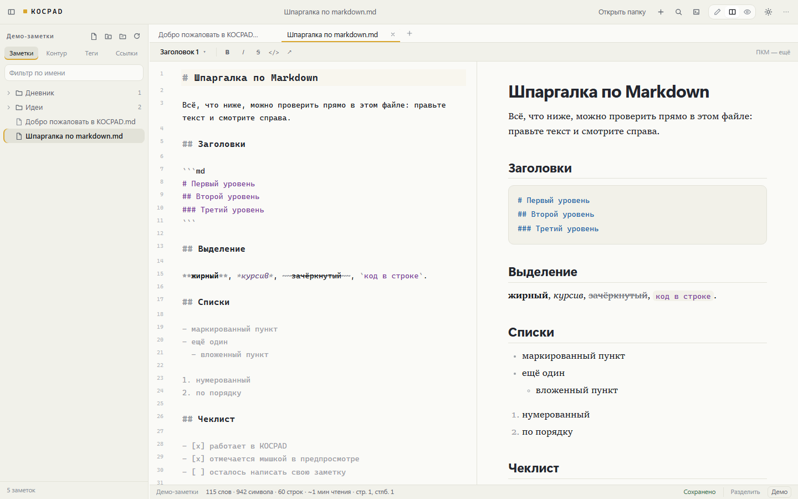
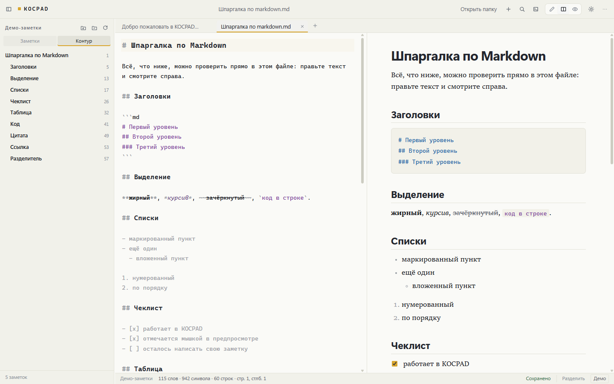
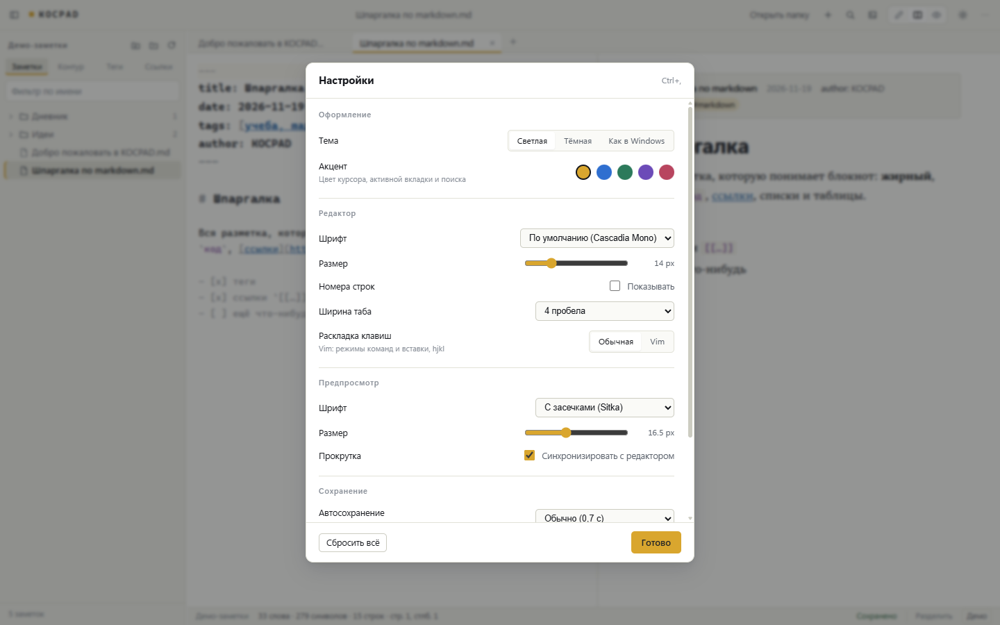

# KOCPAD

[Русский](README.md) · **English**

[](https://github.com/ShiDikALexey/KOCPAD/actions/workflows/build.yml)
[](LICENSE)

**A markdown notepad for Windows — like Notepad, but it remembers everything.**

KOCPAD keeps your notes as plain `.md` files in a folder you choose. It opens
instantly, autosaves as you type, and shows the rendered result next to the
source. No accounts, no database, no proprietary format — just files you can
open in any other editor.

> Status: early alpha (`0.2.0`). The writing workflow works end to end; packaging
> and polish are the next milestone. See [ROADMAP.md](docs/ROADMAP.md).
>
> Download: [installers from the latest release](https://github.com/ShiDikALexey/KOCPAD/releases)
> or the `kocpad-windows` artifact of the [latest build](https://github.com/ShiDikALexey/KOCPAD/actions/workflows/build.yml).



## Why another markdown editor

- **Local-first.** A folder of `.md` files is the whole storage format. Back it up
  with OneDrive, Git, or a USB stick — nothing is locked in.
- **Notepad speed, editor comfort.** Tabs with independent undo history, markdown
  syntax highlighting, find and replace, live preview.
- **Nothing is lost.** Autosave on every pause, tabs restored on the next launch,
  a warning before closing with nothing written.
- **Honest desktop app.** Tauri 2: a small native window using the system WebView2,
  not a browser tab pretending to be an app.

## Features

| Area | What works today |
| --- | --- |
| Notes | Folder of `.md` / `.markdown` / `.mdown` / `.txt` files, tree sidebar, create / rename / delete folders and notes, filter by name |
| Writing | CodeMirror 6 editor, markdown syntax highlighting, soft wrap, per-tab undo history, bold/italic shortcuts |
| Preview | Live GFM render: headings, tables, task lists, code with highlighting, quotes, links; synchronized scrolling |
| Structure | Outline panel listing every heading of the current note, click to jump, current section highlighted |
| Images | Paste or drop an image: it is written to `assets/` next to the note and inserted as markdown; relative images render in the preview |
| Saving | Debounced autosave (0.3 s / 0.7 s / 1.5 s, configurable), explicit `Ctrl+S`, flush on tab switch, window blur and app close |
| Search | In-note find & replace (`Ctrl+F`, `Ctrl+H`), workspace-wide search with match snippets (`Ctrl+Shift+F`) |
| Interface | Light / dark / follow-Windows themes, five accent colours, configurable editor and preview fonts, editor-only and preview-only modes, draggable sidebar and split, Russian UI |
| Files in | Drag `.md` or `.txt` files from Explorer into the window to import and open them |
| Commands | Command palette (`Ctrl+K`) over every action; settings screen (`Ctrl+,`) |
| Export | Standalone HTML file, print-to-PDF through the system print dialog |
| Tasks | Click a checkbox in the preview to toggle `- [ ]` in the source |

## Quick start

### Browser preview (no Rust needed)

```bash
npm install
npm run dev          # http://localhost:1420
```

Open `http://localhost:1420/?demo=1` for a self-contained demo workspace that
needs no folder permission. In Chromium, “Открыть папку” connects a real folder
through the File System Access API.

### Desktop app (Windows)

Requirements:

- [Node.js](https://nodejs.org/) 20+
- [Rust](https://rustup.rs/) stable with the MSVC toolchain
- Visual Studio Build Tools with the **Desktop development with C++** workload
- [WebView2 runtime](https://developer.microsoft.com/microsoft-edge/webview2/) —
  preinstalled on Windows 11 and up-to-date Windows 10

```bash
npm install
npm run tauri:dev      # dev window with hot reload
npm run tauri:build    # installers in src-tauri/target/release/bundle
```

The release build produces an NSIS installer and an MSI under
`src-tauri/target/release/bundle/`, plus the portable exe in
`src-tauri/target/release/kocpad.exe`.

> Nothing is installed system-wide by KOCPAD itself: the NSIS bundle uses
> per-user install mode.

### Checks

```bash
npm run typecheck      # TypeScript, no emit
npm run build          # typecheck + production frontend build
```

## Keyboard shortcuts

| Keys | Action |
| --- | --- |
| `Ctrl+N` | New note |
| `Ctrl+Shift+N` | New folder |
| `Ctrl+O` | Open folder |
| `Ctrl+S` | Save now |
| `Ctrl+W` | Close tab |
| `Ctrl+Tab` / `Ctrl+Shift+Tab` | Next / previous tab |
| `Ctrl+F` | Find in note |
| `Ctrl+H` | Find and replace |
| `Ctrl+Shift+F` | Search the whole workspace |
| `Ctrl+K` | Command palette |
| `Ctrl+,` | Settings |
| `Ctrl+Shift+O` | Outline panel |
| `Ctrl+E` | Cycle editor → split → preview |
| `Ctrl+B` / `Ctrl+I` | Bold / italic |
| `Ctrl+P` | Print (save as PDF) |
| `Ctrl+Shift+E` | Export to HTML |
| `Ctrl+Shift+L` | Toggle dark theme |
| `Ctrl+\` | Toggle sidebar |
| `Ctrl+=` / `Ctrl+-` / `Ctrl+0` | Editor font size |
| `F2` | Rename current note |
| `F5` | Refresh the tree |

Full list with context: [docs/KEYBINDINGS.md](docs/KEYBINDINGS.md).

## Screenshots

| Light | Dark |
| --- | --- |
|  |  |

| Outline panel | Settings |
| --- | --- |
|  |  |


## How it is built

```
KOCPAD
├─ index.html            app shell (static markup, filled by src/main.ts)
├─ src/
│  ├─ main.ts            wiring: theme, layout, shortcuts, actions, autosave
│  ├─ store.ts           single source of truth: settings, tree, tabs, saves
│  ├─ images.ts          pasted images → assets/, relative images → blob URLs
│  ├─ storage/           three backends behind one interface
│  │  ├─ tauri.ts        native build → Rust commands
│  │  ├─ browser.ts      File System Access API + IndexedDB handle
│  │  └─ demo.ts         in-memory sample workspace
│  ├─ editor.ts          CodeMirror 6 wrapper, per-document EditorState
│  ├─ markdown.ts        GFM render, sanitizing, syntax highlight, print/export
│  ├─ ui/                tree, outline, tabs, status bar, dialogs, palette,
│  │                     search, settings
│  ├─ path.ts, util.ts   path and DOM helpers
│  └─ style.css          design tokens, themes, accents, components
├─ src-tauri/            Tauri 2 shell
│  ├─ src/fs_ops.rs      list / read / write / rename / delete / reveal
│  ├─ tauri.conf.json    window, CSP, bundle config
│  └─ capabilities/      dialog permissions for the main window
└─ docs/                 architecture, keybindings, roadmap
```

Design decisions worth knowing:

- **The storage interface is the seam.** UI code never touches `fs`; swapping a
  backend (or adding WebDAV later) touches one file.
- **Documents own their editor state.** Each tab keeps a CodeMirror `EditorState`,
  so undo history and caret survive tab switches.
- **Writes are serialized per path.** Autosave and explicit saves cannot
  interleave; a snapshot is only marked clean after it reached the disk.
- **The Rust side is small on purpose.** Eleven commands, no plugin scopes to
  maintain, one place that decides which files count as notes.

More detail: [docs/ARCHITECTURE.md](docs/ARCHITECTURE.md).

## Roadmap

Near-term: verify the local `.exe` build on a clean machine, code-sign the
installer, and remember window geometry between launches. The full list lives in
[docs/ROADMAP.md](docs/ROADMAP.md).

## Contributing

Issues and pull requests are welcome. Read [CONTRIBUTING.md](CONTRIBUTING.md)
first — it is short: run the typecheck, keep the UI strings and README Russian and
the code English, and do not add a framework without a discussion.

## License

[MIT](LICENSE) © KOCPAD contributors
