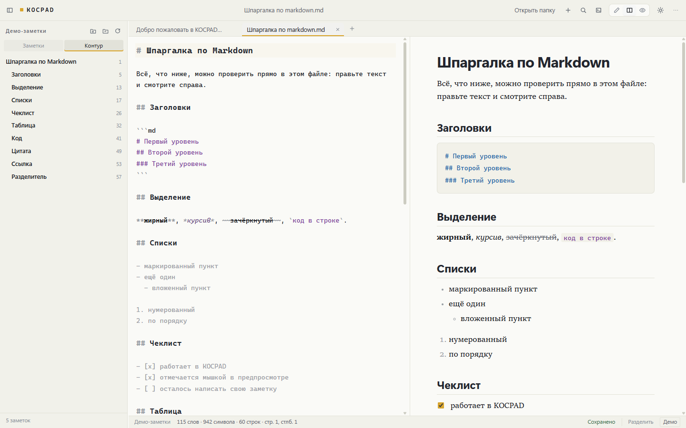
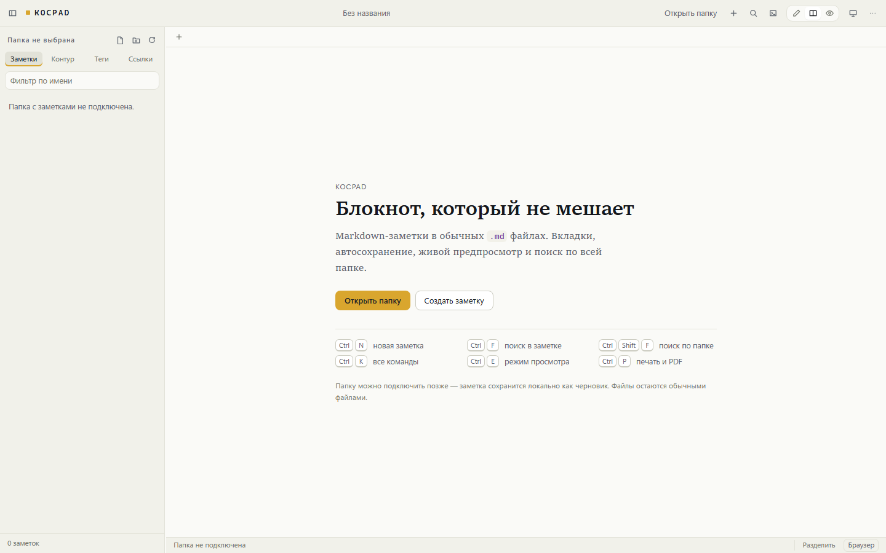
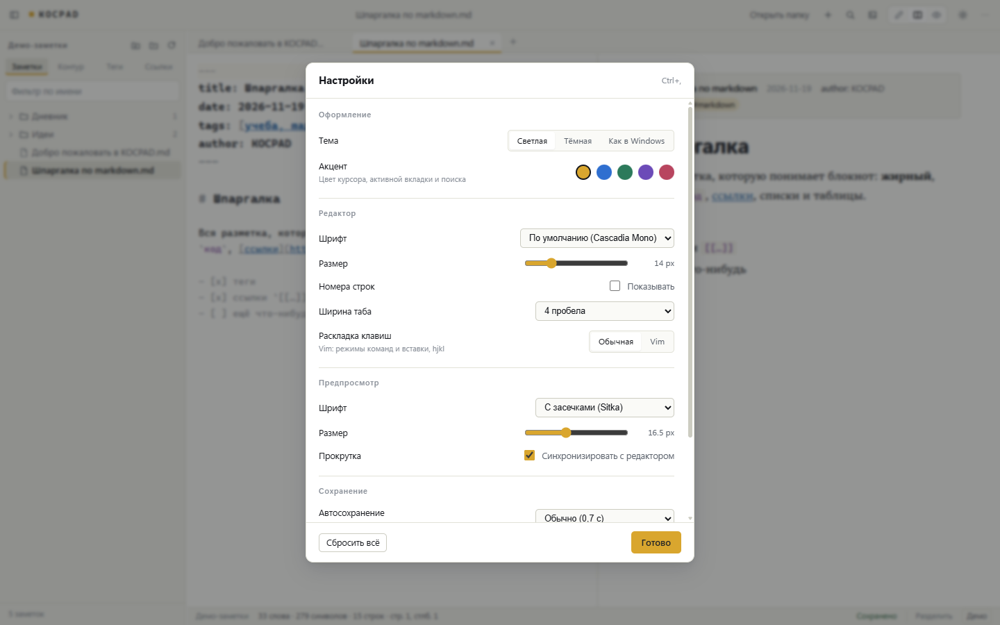

# KOCPAD

**Русский** · [English](README.en.md)

[](https://github.com/ShiDikALexey/KOCPAD/actions/workflows/build.yml)
[](LICENSE)

**Блокнот для markdown-заметок на Windows — как «Блокнот», но ничего не теряет.**

KOCPAD открывается мгновенно, позволяет сразу писать (даже без выбора папки),
сохраняет на диск по мере печати и показывает готовый результат рядом с
исходником. Заметки — обычные `.md` файлы: без аккаунтов, баз данных и своего
формата, они открываются в любом другом редакторе.

> Статус: рабочая альфа **`0.4.0`**. Печатать, сохранять, искать, ставить теги,
> выделять заметки пачкой и закрывать приложение без потерь можно уже сейчас;
> впереди — подпись установщика, ссылки `[[заметка]]` и работа с тысячами заметок.
> План: [docs/ROADMAP.md](docs/ROADMAP.md), история изменений:
> [CHANGELOG.md](CHANGELOG.md).
>
> Скачать: [установщик из последнего релиза](https://github.com/ShiDikALexey/KOCPAD/releases/latest)
> или артефакт `kocpad-windows` из [последней сборки](https://github.com/ShiDikALexey/KOCPAD/actions/workflows/build.yml).


## Скачать и установить

Готовые сборки лежат в [последнем релизе](https://github.com/ShiDikALexey/KOCPAD/releases/latest).
Нужна Windows 10 или 11 (x64) и WebView2 — в Windows 11 он уже есть.

| Файл | Что это |
| --- | --- |
| `KOCPAD_<версия>_x64-setup.exe` | установщик для текущего пользователя (NSIS) — рекомендуемый вариант |
| `KOCPAD_<версия>_x64_en-US.msi` | MSI для установки через групповые политики или Intune |
| `kocpad.exe` | портативная версия: положите в любую папку и запускайте, установка не нужна |

Сборки **не подписаны** сертификатом, поэтому при первом запуске Windows покажет
SmartScreen: «Windows protected your PC» → **Подробнее** → **Выполнить в любом
случае**. Это ожидаемо: в CI уже есть шаг подписи, не хватает только сертификата
([docs/ROADMAP.md](docs/ROADMAP.md)). Установщик ставится для текущего
пользователя и не требует прав администратора.

К релизу приложен `SHA256SUMS.txt` — можно проверить скачанный файл:

```powershell
Get-FileHash .\KOCPAD_0.4.0_x64-setup.exe -Algorithm SHA256
# сравните с соответствующей строкой из SHA256SUMS.txt
```

## Что нового

- **Теги `#тег`.** Панель «Теги» в боковой панели: все теги со счётчиками и
  списком заметок, где они встречаются. Блоки кода не считаются тегами.
- **Массовые действия.** `Ctrl+клик` и `Shift+клик` выделяют несколько заметок,
  дальше — «Переместить» в другую папку или «Удалить» одной пачкой.
- **Черновики без папки.** `Ctrl+N` сразу открывает чистый лист: текст хранится
  локально и возвращается после перезапуска, а «Сохранить в папку…» превращает
  черновик в обычный `.md`.
- **Закрытие без потерь.** При выходе KOCPAD спрашивает: сохранить черновики в
  папку, оставить как черновики или удалить.
- **Память окна и папок.** Размер и положение окна, последняя папка, открытые
  вкладки и список недавних папок в палитре — всё восстанавливается.
- **Онбординг в один шаг.** При первом запуске: «Начать с черновика» или
  «Открыть папку заметок».
- **Настройки под себя.** Ширина таба (2/4/8), раскладка Vim, шрифты и размеры,
  пять акцентов, задержка автосохранения.
- **Полностью русский интерфейс**, включая панель поиска и замены.


## Зачем ещё один markdown-редактор

- **Локально и без заложников.** Папка с `.md` файлами — это и есть всё хранилище.
  Бэкапьте OneDrive, Git или флешкой: ничего не заблокировано.
- **Скорость «Блокнота», удобство редактора.** Вкладки с собственной историей
  отмены, подсветка markdown, поиск и замена, живой предпросмотр.
- **Ничего не теряется.** Автосохранение на каждой паузе, черновики и вкладки
  возвращаются после перезапуска, при закрытии приложение спрашивает о несохранённом.
- **Честное настольное приложение.** Tauri 2: небольшое нативное окно на системном
  WebView2, а не вкладка браузера, которая притворяется программой.

## Возможности

| Область | Что уже работает |
| --- | --- |
| Заметки | Папка с файлами `.md` / `.markdown` / `.mdown` / `.txt`, дерево в боковой панели, создание, переименование и удаление заметок и папок, фильтр по имени |
| Теги | Инлайн-теги `#тег` и `#работа/проект`: панель «Теги» со счётчиками, список заметок с выбранным тегом; теги в блоках кода игнорируются |
| Массовые действия | `Ctrl+клик` — добавить заметку к выделению, `Shift+клик` — диапазон, `Esc` — снять. «Переместить» в любую папку рабочей папки или «Удалить» одной пачкой |
| Черновики | Новая заметка (`Ctrl+N`) появляется сразу и не требует папки: текст автоматически хранится локально и возвращается после перезапуска. «Сохранить в папку…» (`Ctrl+S`) превращает черновик в обычный `.md` файл, `F2` меняет название |
| Закрытие | При выходе — выбор: сохранить черновики в папку, оставить черновиками или удалить. Если папка не отвечает, окно всё равно закрывается |
| Папка | Открыть папку, закрыть её и подключить другую; последняя папка запоминается между запусками, недавние папки доступны в палитре `Ctrl+K`, вкладки восстанавливаются |
| Окно | Размер и положение окна запоминаются между запусками |
| Письмо | Редактор CodeMirror 6, подсветка markdown, перенос строк, своя история отмены на вкладку, `Ctrl+B` / `Ctrl+I`, ширина таба (2/4/8), раскладка Vim |
| Предпросмотр | Живой GFM: заголовки, таблицы, чеклисты, код с подсветкой, цитаты, ссылки; синхронная прокрутка |
| Структура | Панель «Контур»: все заголовки текущей заметки, переход по клику, подсветка текущего раздела |
| Картинки | Вставка из буфера или перетаскиванием: файл пишется в `assets/` рядом с заметкой, в текст вставляется markdown, относительные картинки рендерятся в предпросмотре |
| Сохранение | Автосохранение с задержкой (0,3 / 0,7 / 1,5 с, настраивается), явное `Ctrl+S`, сброс при переключении вкладки, потере фокуса и закрытии |
| Поиск | Поиск и замена в заметке (`Ctrl+F`, `Ctrl+H`) с русской панелью, поиск по всей папке с фрагментами строк (`Ctrl+Shift+F`), черновики тоже ищутся |
| Интерфейс | Светлая, тёмная и «как в Windows» темы, пять акцентов, настраиваемые шрифты редактора и предпросмотра, режимы «редактор / разделить / просмотр», перетаскиваемые панели |
| Файлы извне | Перетащите `.md` или `.txt` из проводника в окно — заметка импортируется в текущую папку и откроется |
| Команды | Палитра команд (`Ctrl+K`) для любого действия, экран настроек (`Ctrl+,`) |
| Экспорт | Отдельный HTML-файл, печать в PDF через системный диалог |
| Задачи | Клик по чекбоксу в предпросмотре переключает `- [ ]` в исходнике |

## Быстрый старт

### Посмотреть в браузере (Rust не нужен)

```bash
npm install
npm run dev          # http://localhost:1420
```

Откройте `http://localhost:1420/?demo=1` — демо-папка, доступ к диску не
запрашивается. В Chromium кнопка «Открыть папку» подключает настоящую папку через
File System Access API.

### Настольное приложение (Windows)

Что нужно:

- [Node.js](https://nodejs.org/) 20+
- [Rust](https://rustup.rs/) stable с тулчейном MSVC
- Visual Studio Build Tools с нагрузкой **«Разработка классических приложений на C++»**
- [WebView2](https://developer.microsoft.com/microsoft-edge/webview2/) — уже есть в
  Windows 11 и в актуальной Windows 10

```bash
npm install
npm run tauri:dev      # окно с горячей перезагрузкой
npm run tauri:build    # установщики в src-tauri/target/release/bundle
```

Сборка кладёт NSIS-установщик и MSI в `src-tauri/target/release/bundle/`, а
портативный exe — в `src-tauri/target/release/kocpad.exe`.

> KOCPAD ничего не ставит в систему: NSIS-сборка ставится для текущего
> пользователя.

### Проверки

```bash
npm run typecheck      # типы TypeScript, без сборки
npm run build          # типы + прод-сборка фронтенда
```

## Горячие клавиши

| Клавиши | Действие |
| --- | --- |
| `Ctrl+N` | Новая заметка (создаётся сразу, без диалога имени) |
| `Ctrl+Shift+N` | Новая папка |
| `Ctrl+O` | Открыть папку |
| `Ctrl+S` | Сохранить сейчас (черновик — «Сохранить в папку…») |
| `Ctrl+W` | Закрыть вкладку |
| `Ctrl+Tab` / `Ctrl+Shift+Tab` | Следующая / предыдущая вкладка |
| `Ctrl+F` | Поиск в заметке |
| `Ctrl+H` | Поиск и замена |
| `Ctrl+Shift+F` | Поиск по всей папке |
| `Ctrl+K` | Палитра команд |
| `Ctrl+,` | Настройки |
| `Ctrl+Shift+O` | Панель «Контур» |
| `Ctrl+E` | Переключить редактор → разделить → просмотр |
| `Ctrl+B` / `Ctrl+I` | Жирный / курсив |
| `Ctrl+P` | Печать (сохранить в PDF) |
| `Ctrl+Shift+E` | Экспорт в HTML |
| `Ctrl+Shift+L` | Переключить тёмную тему |
| `Ctrl+\` | Показать или скрыть боковую панель |
| `Ctrl+=` / `Ctrl+-` / `Ctrl+0` | Размер текста в редакторе |
| `F2` | Переименовать заметку или черновик |
| `F5` | Обновить дерево заметок |

Полный список с контекстом (и раздел про Vim): [docs/KEYBINDINGS.md](docs/KEYBINDINGS.md).

В дереве заметок: `Ctrl+клик` добавляет заметку к выделению, `Shift+клик` берёт
диапазон, `Esc` снимает выделение и возвращает обычный режим.

## Скриншоты

| Светлая тема | Тёмная тема |
| --- | --- |
|  |  |

| Поиск по всем заметкам | Панель «Контур» |
| --- | --- |
|  |  |

| Панель «Теги» | Массовые действия |
| --- | --- |
|  |  |

| Первый запуск | Черновик без папки |
| --- | --- |
|  |  |



## Как устроено

```
KOCPAD
├─ index.html            оболочка приложения (разметка, наполняется из src/main.ts)
├─ src/
│  ├─ main.ts            связка: темы, раскладка, горячие клавиши, автосохранение
│  ├─ store.ts           единственный владелец состояния: настройки, дерево, вкладки
│  ├─ drafts.ts          черновики без файла: хранение в localStorage
│  ├─ tags.ts            разбор инлайн-тегов #тег (без блоков кода)
│  ├─ images.ts          картинки в assets/, относительные пути → blob-URL
│  ├─ storage/           три бэкенда за одним интерфейсом
│  │  ├─ tauri.ts        нативная сборка → команды Rust
│  │  ├─ browser.ts      File System Access API + дескриптор папки в IndexedDB
│  │  └─ demo.ts         демо-папка в памяти
│  ├─ editor.ts          обёртка CodeMirror 6, свой EditorState на документ
│  ├─ markdown.ts        GFM-рендер, санитайзинг, подсветка кода, печать
│  ├─ ui/                дерево, контур, теги, вкладки, статусбар, диалоги,
│  │                     выбор папки, палитра, поиск, настройки
│  ├─ path.ts, util.ts   помощники для путей и DOM
│  └─ style.css          токены дизайна, темы, акценты, компоненты
├─ scripts/              bump-version.cjs — версия в трёх файлах без рассинхрона
├─ src-tauri/            оболочка Tauri 2
│  ├─ src/fs_ops.rs      список / чтение / запись / переименование / удаление
│  ├─ src/lib.rs         окно, память геометрии, перехват закрытия
│  ├─ tauri.conf.json    окно, CSP, сборка установщиков
│  └─ capabilities/      права на диалоги для главного окна
└─ docs/                 архитектура, клавиши, план развития
```

Решения, которые полезно знать:

- **Интерфейс хранилища — это шов.** UI никогда не трогает `fs`; чтобы заменить
  бэкенд (или добавить WebDAV), достаточно одного файла.
- **Документ владеет состоянием редактора.** Каждая вкладка хранит свой
  `EditorState` CodeMirror, поэтому история отмены и каретка переживают
  переключение.
- **Запись сериализуется по пути.** Автосохранение и явное сохранение не
  переплетаются; снимок считается сохранённым только после записи на диск.
- **Черновик — это документ без файла.** `draft:<id>` живёт в тех же вкладках, что
  и файлы, но пишется в localStorage, а не на диск.
- **Rust-сторона намеренно маленькая.** Тринадцать команд, никаких scope-ов
  плагинов, одно место, где решается, какие файлы считаются заметками.

Подробнее: [docs/ARCHITECTURE.md](docs/ARCHITECTURE.md).

## План развития

Ближайшее: подписать установщик (нужен сертификат OV/EV — шаг в CI готов) и
проверить работу на чистой машине. Дальше — ссылки `[[заметка]]` с обратными
ссылками, индекс поиска и ленивое дерево для тысяч заметок. Полный список —
[docs/ROADMAP.md](docs/ROADMAP.md), история версий —
[CHANGELOG.md](CHANGELOG.md), все релизы —
[Releases](https://github.com/ShiDikALexey/KOCPAD/releases).

## Участие

Issues и pull request'ы приветствуются. Сначала прочитайте
[CONTRIBUTING.md](CONTRIBUTING.md): запускать typecheck, интерфейс и README — по-русски,
код и комментарии — по-английски, фреймворк без обсуждения не добавлять.

## Лицензия

[MIT](LICENSE) © участники KOCPAD
