<div align="center">
  
  <h1>KOCPAD</h1>
  <p><b>Блокнот для markdown-заметок на Windows — как «Блокнот», но ничего не теряет.</b></p>

  [](https://github.com/ShiDikALexey/KOCPAD/actions/workflows/build.yml)
  [](https://github.com/ShiDikALexey/KOCPAD/releases/latest)
  [](#требования)
  [](LICENSE)

  <sub>Русский · <a href="README.en.md">English</a></sub>
</div>

---

**KOCPAD** открывается мгновенно и сразу даёт писать — даже без выбора папки.
Текст сохраняется на диск по мере печати, рядом показывается готовый результат.
Заметки — обычные `.md` файлы: без аккаунтов, баз данных и своего формата, они
открываются в любом другом редакторе.

> **Статус:** `1.2.0` — рабочая версия для повседневного письма. 21 автотест
> интерфейса гоняются в CI на каждый пуш. Осталось внешнее: подпись установщика
> сертификатом и прогон на чистой машине — см. [планы](docs/ROADMAP.md).
>
> **Скачать:** [последний релиз](https://github.com/ShiDikALexey/KOCPAD/releases/latest) —
> установщик `.exe`, пакет `.msi`, портативный `kocpad.exe` и `SHA256SUMS.txt`.

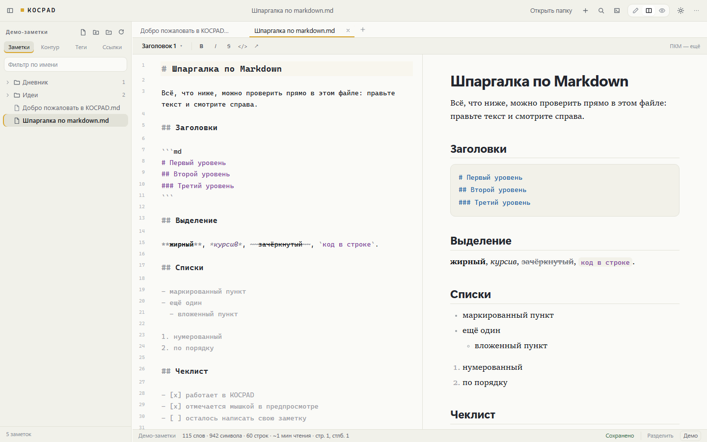

## Содержание

- [Что это](#что-это)
- [Чем отличается](#чем-отличается)
- [Возможности](#возможности)
- [Установка](#установка)
- [Первый запуск](#первый-запуск)
- [Где хранятся данные](#где-хранятся-данные)
- [Горячие клавиши](#горячие-клавиши)
- [Скриншоты](#скриншоты)
- [Сборка из исходников](#сборка-из-исходников)
- [Тесты и CI](#тесты-и-ци)
- [Как устроено](#как-устроено)
- [Документация](#документация)
- [Ограничения и планы](#ограничения-и-планы)
- [Вопросы и ответы](#вопросы-и-ответы)
- [Участие в разработке](#участие-в-разработке)
- [Лицензия](#лицензия)

## Что это

KOCPAD — редактор заметок для Windows, сделанный по принципу «блокнот, только без
потерь». Идея простая: открыть, писать, закрыть. Всё остальное — вкладки,
автосохранение, предпросмотр, теги и связи — существует, чтобы не мешать, а не
чтобы красоваться.

Философия проекта:

- **Файлы, а не база данных.** Рабочая папка — это просто папка с `.md` файлами.
  Её можно синхронизировать чем угодно (OneDrive, Яндекс.Диск, git), открыть в
  Obsidian, VS Code или на телефоне. Удалить KOCPAD — заметки останутся.
- **Локально и без аккаунтов.** Нет регистрации, облака, телеметрии и сетевых
  запросов «на всякий случай». В сеть приложение ходит только когда вы сами
  нажимаете внешнюю ссылку.
- **Сначала письмо.** Никаких плагинов и маркетплейсов: только то, что нужно,
  чтобы писать и находить написанное.

## Чем отличается

| | KOCPAD | Блокнот Windows | Obsidian | Joplin |
|---|---|---|---|---|
| Формат хранения | обычные `.md` в вашей папке | `.txt` | своя папка-хранилище | своя база + синк |
| Markdown и предпросмотр | да, GFM, живой | нет | да | да |
| Вкладки и автосохранение | да | нет | да | да |
| Теги и связи `[[…]]` | да | нет | да | частично |
| Аккаунт и интернет обязательны | нет | нет | нет | для синка |
| Плагины и темы | нет (осознанно) | нет | да | да |
| Размер и запуск | мгновенно | мгновенно | зависит от хранилища | зависит от базы |

KOCPAD — не замена Obsidian для «второго мозга» и не замена Joplin для синка.
Это быстрый блокнот, в котором приятно писать и который ничего не теряет.

## Возможности

### Заметки и файлы

| Возможность | Как это работает |
|---|---|
| Папка заметок | Дерево `.md` / `.markdown` / `.mdown` / `.txt` в боковой панели; фильтр по имени |
| Заметки и папки | Создание, переименование (`F2`), удаление, контекстные меню, перетаскивание `.md` в окно |
| Вкладки | Несколько заметок одновременно, `Ctrl+Tab` переключает, `Ctrl+W` закрывает; каждая вкладка помнит свою историю отмен |
| Автосохранение | Пишет на диск по мере печати (задержка настраивается), `Ctrl+S` сохраняет сразу; атомарная запись через временный файл |
| Черновики | `Ctrl+N` сразу открывает чистый лист, даже без папки; текст живёт локально и возвращается после перезапуска |
| Массовые действия | `Ctrl+клик` и `Shift+клик` в дереве: переместить пачку заметок в другую папку или удалить одним подтверждением |

### Письмо и разметка

| Возможность | Как это работает |
|---|---|
| Подсветка Markdown | CodeMirror 6: заголовки, списки, ссылки, код, таблицы |
| Живой предпросмотр | Панель справа, синхронизированная прокрутка; режимы «редактор», «разделить», «просмотр» |
| GFM | Таблицы, чек-листы, зачёркивание, автолинки, сноски |
| Форматирование | `Ctrl+B` жирный, `Ctrl+I` курсив, ``Ctrl+` `` код, `Ctrl+Shift+K` ссылка; повторное нажатие снимает разметку |
| Панель типа блока | Поле над редактором показывает текущий блок и переключает его: текст, заголовки 1–3, список, нумерованный, чек-лист, цитата, блок кода, разделитель |
| Контекстное меню | Правая кнопка мыши в тексте: вырезать/копировать/вставить, форматирование, преобразование блока, поиск выделенного, снятие разметки |
| Front matter | Блок `---` с `title`, `date`, `tags` и любыми `ключ: значение` показывается карточкой над текстом |
| Режим сосредоточения | `Ctrl+Shift+Z`: одна узкая колонка текста, без панелей и предпросмотра; `Esc` — выход |
| Vim | Необязательная раскладка (`hjkl`, режимы), загружается по требованию из настроек |
| Ширина таба | 2, 4 или 8 пробелов, глобально |

### Поиск, теги и связи

| Возможность | Как это работает |
|---|---|
| Поиск в заметке | `Ctrl+F`: поиск и замена, регистр, регулярные выражения, слово целиком — панель на русском |
| Поиск по папке | `Ctrl+Shift+F`: все заметки с контекстом, группировка по файлу, переход к строке |
| Теги | Инлайн `#тег` и `#работа/проект`; панель «Теги» со счётчиками и списком заметок; теги из front matter тоже учитываются |
| Связи `[[заметка]]` | Автодополнение по `[[`, кликабельные ссылки в предпросмотре, панель «Связи» с обратными ссылками; алиасы `[[Заметка\|текст]]` |
| Контур | Все заголовки заметки с переходом по клику и подсветкой текущего раздела |
| Палитра команд | `Ctrl+K`: команды, недавние папки и недавние заметки |
| Кэш текста | Поиск, теги и связи не перечитывают папку каждый раз: текст кэшируется после первого чтения |

### Экспорт и настройки

| Возможность | Как это работает |
|---|---|
| HTML | Отдельный самодостаточный файл со стилями; светлая или тёмная тема экспорта |
| PDF | Печать через системный диалог (PDF-принтер Windows) |
| Настройки | `Ctrl+,`: тема (светлая/тёмная/как в Windows), пять акцентов, шрифты и размеры редактора и предпросмотра, ширина таба, Vim, номера строк, синхронная прокрутка, задержка автосохранения, тема экспорта |
| Память окна | Размер и положение окна, последняя папка, открытые вкладки, недавние папки и заметки |
| Масштаб | Большие папки рисуются порциями по 150 строк («Показать ещё»), фильтр ограничен 300 результатами |

### Надёжность

- Атомарная запись: заметка не останется половинчатой при сбое.
- Закрытие окна перехватывается: приложение спросит, что делать с незакрытыми
  черновиками (сохранить в папку, оставить или удалить).
- Никаких «фоновых миграций» и перезаписи ваших файлов без сохранения.

## Установка

### Требования

- Windows 10 или 11, x64.
- WebView2 Runtime — в Windows 11 уже есть; на Windows 10 установщик обычно
  подтягивает его автоматически, если нет — поставьте
  [WebView2 Runtime](https://developer.microsoft.com/microsoft-edge/webview2/) отдельно.
- Права администратора не нужны: установка идёт в профиль пользователя.

### Варианты установки

| Файл в релизе | Для чего |
|---|---|
| `KOCPAD_<версия>_x64-setup.exe` | Обычный установщик (NSIS): ярлыки, удаление через «Приложения» |
| `KOCPAD_<версия>_x64_en-US.msi` | MSI для тех, кто ставит через групповые политики или `msiexec` |
| `kocpad.exe` | Портативная версия: запускается из любой папки без установки |
| `SHA256SUMS.txt` | Контрольные суммы всех файлов релиза |

### SmartScreen

Сборки пока **не подписаны** сертификатом, поэтому при первом запуске Windows
показывает «Windows защитила ваш компьютер»: **Подробнее → Выполнить в любом
случае**. Это ожидаемо: шаг подписи в CI готов, не хватает только сертификата
([подробнее](docs/ROADMAP.md)). Подпись появится в одном из следующих релизов.

### Проверка контрольной суммы

```powershell
Get-FileHash .\KOCPAD_1.2.0_x64-setup.exe -Algorithm SHA256
# сравните с соответствующей строкой из SHA256SUMS.txt
```

## Первый запуск

1. Приложение показывает один диалог: **«Начать с черновика»** или
   **«Открыть папку заметок»**.
2. Черновик — это заметка без файла: можно писать сразу, а потом сохранить в папку
   (`Ctrl+S`). Черновики переживают перезапуск.
3. Папка — любая папка на диске с `.md` файлами. KOCPAD запомнит её и откроет при
   следующем запуске.
4. Закрытие окна с непустыми черновиками спросит, что с ними делать.

## Где хранятся данные

| Что | Где |
|---|---|
| Заметки | Ваши `.md` файлы в выбранной папке — единственный источник правды |
| Картинки, вставленные в заметку | Подпапка `assets/` рядом с заметкой |
| Черновики (заметки без файла) | Локальное хранилище профиля приложения (`localStorage`, ключ `kocpad.drafts`) |
| Настройки, вкладки, недавние папки | Локальное хранилище профиля приложения |
| Кэш текста, история отмен | Память процесса; на диск не пишется |

Ничего не отправляется в интернет. В сеть приложение обращается только когда вы
сами кликаете внешнюю ссылку в заметке (открывается в системном браузере).

Удаление приложения не удаляет заметки: они лежат в вашей папке.

## Горячие клавиши

| Клавиши | Действие |
|---|---|
| `Ctrl+N` | Новая заметка сразу, без диалога имени |
| `Ctrl+Alt+N` | Быстрый захват из любого приложения (глобальный хоткей) |
| `Ctrl+Shift+N` | Новая папка |
| `Ctrl+O` | Открыть папку заметок |
| `Ctrl+S` / `Ctrl+Shift+S` | Сохранить / сохранить всё |
| `Ctrl+F` / `Ctrl+H` / `Ctrl+Shift+F` | Поиск в заметке / замена / поиск по всей папке |
| `Ctrl+K` | Палитра команд |
| `Ctrl+W` / `Ctrl+Tab` | Закрыть вкладку / следующая вкладка |
| `Ctrl+,` | Настройки |
| `Ctrl+B` / `Ctrl+I` / `` Ctrl+` `` / `Ctrl+Shift+K` | Жирный, курсив, код, ссылка (повтор — снять) |
| `Ctrl+Alt+1` / `Ctrl+Alt+2` / `Ctrl+Alt+3` | Заголовок 1 / 2 / 3 для текущей строки или выделения |
| `Ctrl+Alt+0` | Вернуть блок в обычный текст |
| Правая кнопка мыши в тексте | Контекстное меню: буфер обмена, форматирование, типы блоков, поиск выделенного |
| `Ctrl+Shift+Z` / `Esc` | Режим сосредоточения / выход из него |
| `Ctrl+Shift+O` | Контур заметки |
| `Ctrl+=` / `Ctrl+-` / `Ctrl+0` | Размер шрифта больше / меньше / сброс |
| `Ctrl+\` | Свернуть панель заметок |
| `Ctrl+P` | Печать в PDF |
| `Ctrl+Shift+E` | Переключить тему |
| `F2` / `F5` | Переименовать заметку или черновик / обновить дерево |
| `Ctrl+клик`, `Shift+клик`, `Esc` | Выделение нескольких заметок в дереве / снятие выделения |

Полный список с контекстом (включая Vim): [docs/KEYBINDINGS.md](docs/KEYBINDINGS.md).

## Скриншоты

| Светлая тема | Тёмная тема |
| --- | --- |
|  | 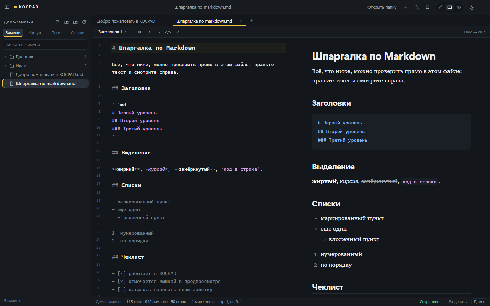 |

| Поиск по заметкам | Контур заметки |
| --- | --- |
| 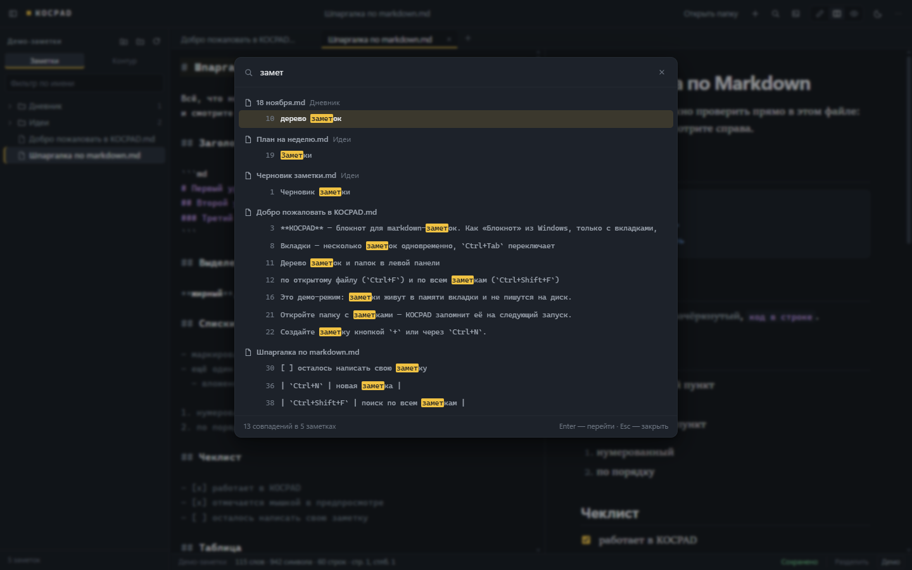 |  |

| Панель «Теги» | Массовые действия |
| --- | --- |
| 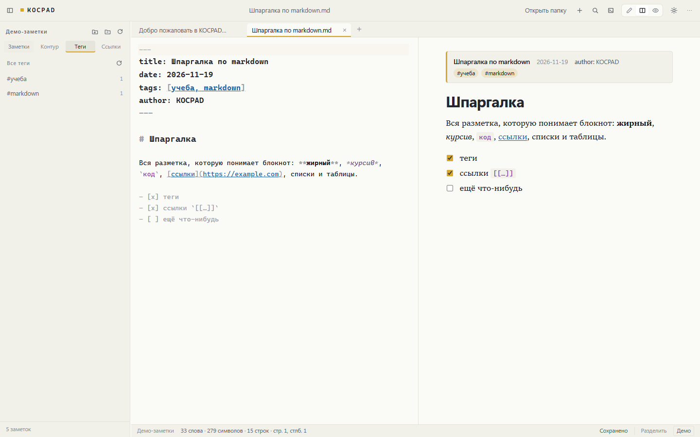 | 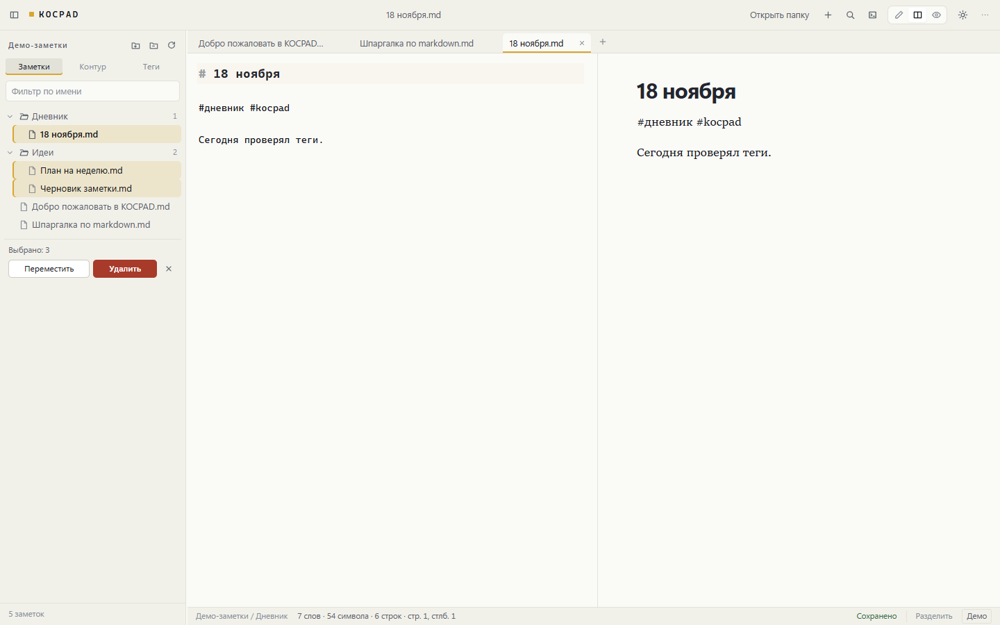 |

| Панель «Связи» | Ссылки в предпросмотре |
| --- | --- |
| 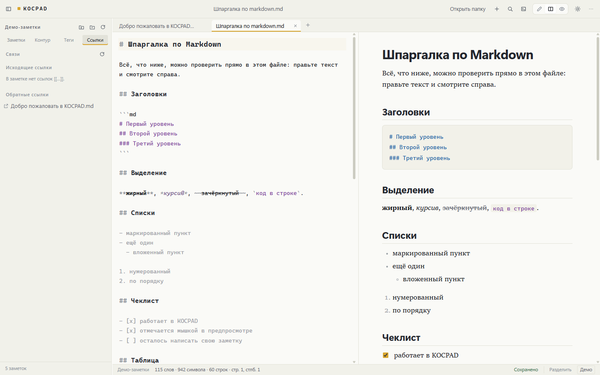 | 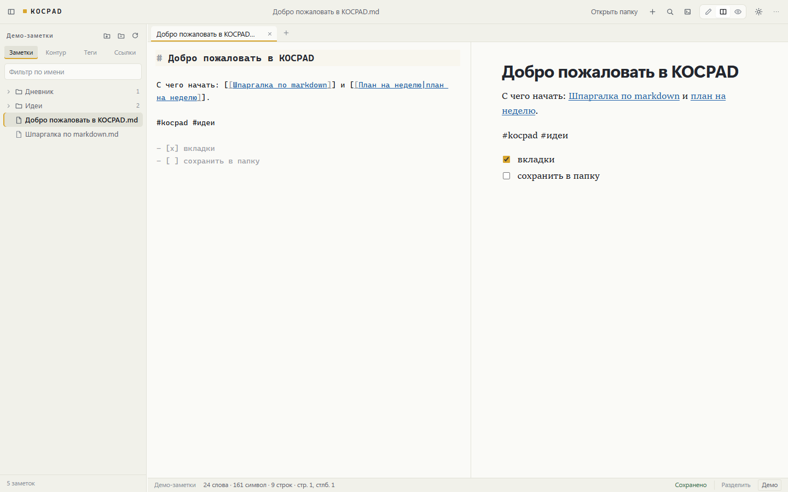 |

| Front matter | Настройки |
| --- | --- |
| 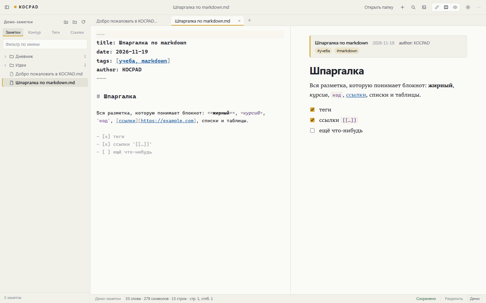 |  |

| Режим сосредоточения | Черновик без папки |
| --- | --- |
| 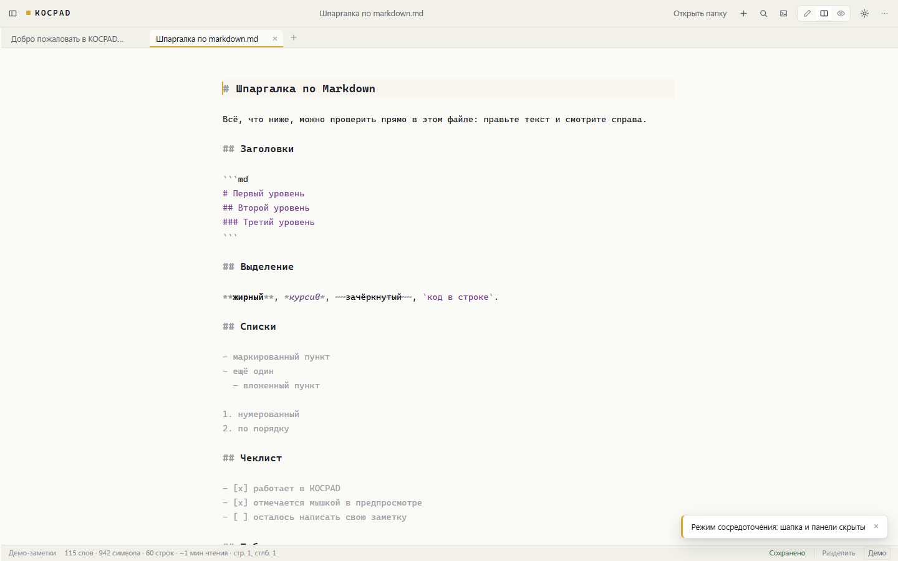 | 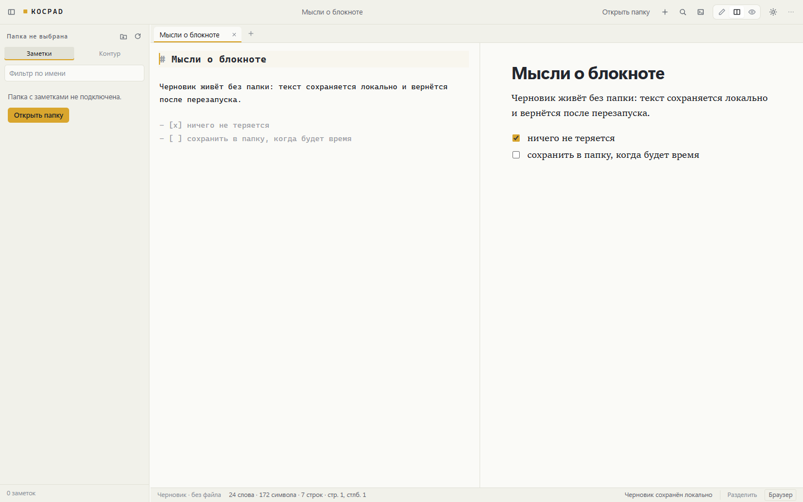 |

| Первый запуск | Панель поиска и замены |
| --- | --- |
|  | 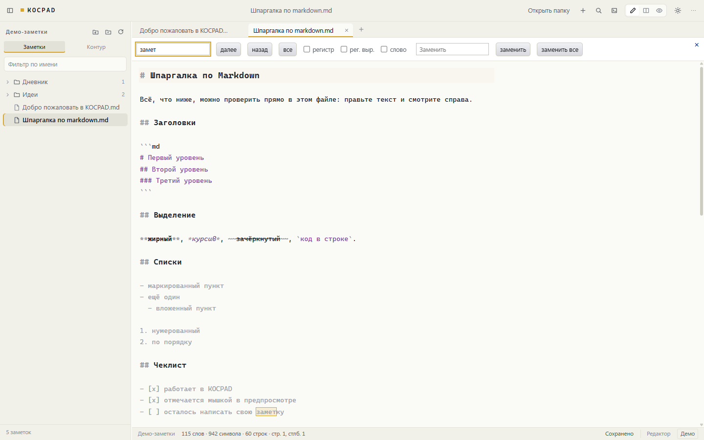 |

| Панель форматирования | Контекстное меню |
| --- | --- |
| 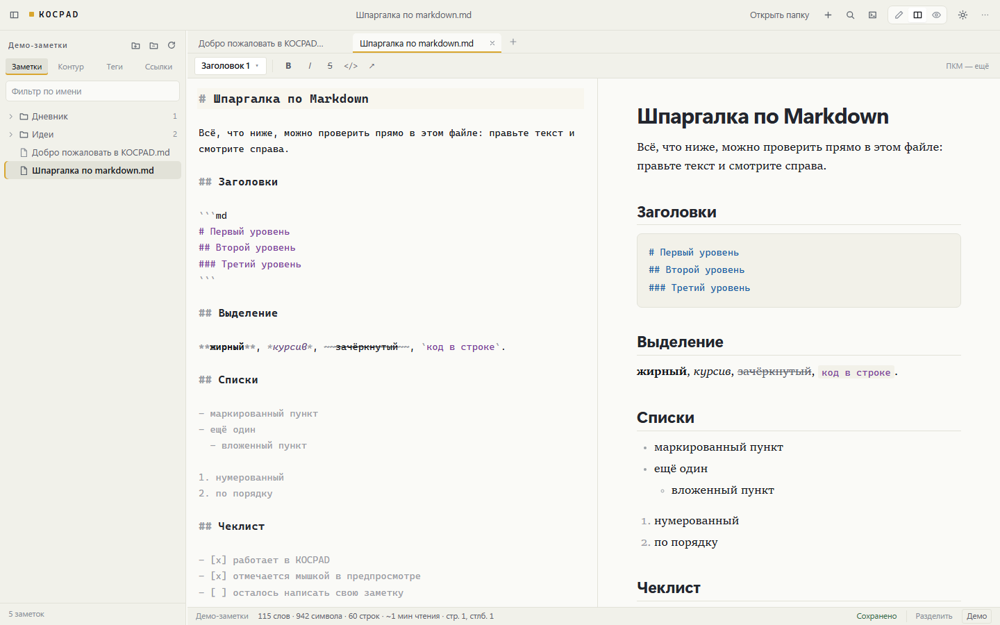 | 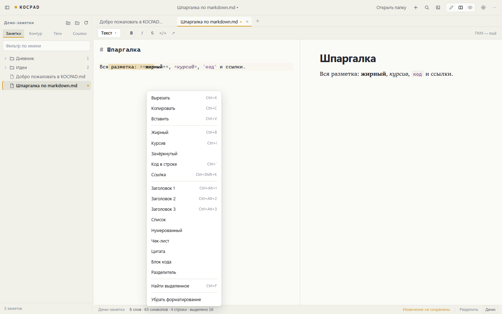 |

## Сборка из исходников

Нужны: [Node.js](https://nodejs.org/) 20 или новее, [Rust](https://rustup.rs/)
1.77.2 или новее (с MSVC toolchain), WebView2 Runtime.

```bash
npm ci                # зависимости фронтенда
npm run tauri:dev     # запуск приложения в dev-режиме (Vite + Rust)
npm run tauri:build   # сборка установщиков в src-tauri/target/release/bundle
```

Фронтенд можно запускать и без Rust — в браузере:

```bash
npm run dev           # http://localhost:1420, откроется демо-режим
npm run dev -- --open # или: браузерная папка через File System Access API
```

Три хранилища выбираются автоматически:

| Среда | Хранилище |
|---|---|
| Приложение Tauri | Настоящая файловая система через команды Rust |
| Браузер (`npm run dev`) | File System Access API + IndexedDB для запоминания папки |
| Демо (`?demo=1`) | Память: несколько заметок-примеров, ничего не пишется на диск |

Версия меняется одной командой (правит `package.json`, `Cargo.toml` и
`tauri.conf.json` без UTF-8 BOM):

```bash
node scripts/bump-version.cjs 1.2.0
```

## Тесты и CI

```bash
npm run typecheck     # строгий TypeScript, без сборки
npm run build         # типы + прод-сборка фронтенда
npm run test:e2e      # 21 сценарий Playwright (dev-сервер поднимается сам)
```

Что покрыто e2e: открытие рабочего пространства, живой предпросмотр,
автосохранение, вкладки, поиск и его русская панель, front matter, ссылки
`[[…]]` и обратные ссылки, теги, настройки, черновики и их восстановление после
перезагрузки, режим сосредоточения, форматирование, панель типа блока,
контекстное меню по ПКМ, снятие разметки, недавние заметки в палитре, время
чтения и **регресс-тест на скорость набора** (дерево не должно перерисовываться
на каждый символ).

CI (`.github/workflows/build.yml`) на каждый пуш и тег:

1. **frontend** — `npm ci`, `tsc --noEmit`, `vite build`, защита от UTF-8 BOM в
   конфигурационных файлах.
2. **e2e** — Playwright Chromium, `npm run test:e2e`, отчёт в артефактах.
3. **windows** — `npm run tauri:build`, установщик, MSI и портативный exe.
4. **release** — на тег `v*`: ассеты релиза и `SHA256SUMS.txt` генерируются
   автоматически (подпись подключается двумя секретами с сертификатом).

## Как устроено

Ядро — веб-приложение (TypeScript + CodeMirror 6), упакованное в Tauri 2. Весь
доступ к диску идёт через интерфейс `Storage`, у которого три реализации; логика
приложения не знает, где лежат файлы. Подробности — в
[docs/ARCHITECTURE.md](docs/ARCHITECTURE.md).

```
KOCPAD/
├─ index.html            разметка окна
├─ src/
│  ├─ main.ts            сборка приложения: события, панели, команды, диалоги
│  ├─ store.ts           состояние: вкладки, дерево, настройки, автосохранение, кэш текста
│  ├─ editor.ts          CodeMirror: подсветка, панель поиска на русском, Vim, форматирование
│  ├─ markdown.ts        рендер GFM, санитайзинг, подсветка кода, экспорт и печать
│  ├─ tags.ts            разбор инлайн-тегов #тег (без блоков кода)
│  ├─ wikilinks.ts       разбор и отрисовка ссылок [[заметка]]
│  ├─ frontmatter.ts     разбор блока --- и карточка метаданных
│  ├─ drafts.ts          черновики без файла в localStorage
│  ├─ images.ts          картинки в assets/, относительные пути → blob-URL
│  ├─ storage/           Tauri, браузер (File System Access), демо
│  ├─ ui/                дерево, контур, теги, связи, вкладки, статусбар, диалоги,
│  │                     выбор папки, палитра, поиск, настройки
│  └─ style.css          темы, акценты, вёрстка
├─ src-tauri/            оболочка: окно, память геометрии, глобальный хоткей,
│                        перехват закрытия, команды файловой системы
├─ tests/                21 сценарий Playwright
├─ docs/                 архитектура, клавиши, планы, публикация, скриншоты
└─ scripts/              bump-version.cjs — версия в трёх файлах без рассинхрона
```

Технологии: Tauri 2, Rust, Vite 8, TypeScript 7, CodeMirror 6, marked 18,
DOMPurify 3.4, highlight.js 11, Playwright 1.65.

## Документация

| Документ | О чём |
|---|---|
| [docs/ARCHITECTURE.md](docs/ARCHITECTURE.md) | Как устроено: хранилища, жизненный цикл документов, темы событий, панели |
| [docs/KEYBINDINGS.md](docs/KEYBINDINGS.md) | Все клавиши, мышь, режим Vim |
| [docs/ROADMAP.md](docs/ROADMAP.md) | Что сделано и что дальше, включая честные «не будем» |
| [docs/PUBLISHING.md](docs/PUBLISHING.md) | Релизы, секреты CI, подпись установщика |
| [CONTRIBUTING.md](CONTRIBUTING.md) | Как собрать, проверить и прислать изменение |
| [CHANGELOG.md](CHANGELOG.md) | История версий |

## Ограничения и планы

Честно о том, чего нет:

- **Нет подписи сертификатом** — SmartScreen предупреждает при первом запуске.
  Нужен OV/EV-сертификат, шаг в CI уже готов.
- **Одна папка на окно.** Осознанное упрощение: так нет путаницы «какая заметка из
  какой папки». Можно открыть второе окно приложения.
- **Нет синхронизации и аккаунтов.** Синхронизируйте папку любым удобным
  способом — файлы обычные.
- **Нет плагинов и CMS-возможностей.** Это блокнот, а не платформа.
- **Нет мобильной версии.** В бэклоге.

Дальше в планах: две заметки рядом, необязательное шифрование папки, мобильная
сборка. Полный список и статусы — [docs/ROADMAP.md](docs/ROADMAP.md).

## Вопросы и ответы

**Это безопасно?** Данные лежат локально, телеметрии и аккаунтов нет. В сеть
приложение не ходит, пока вы не откроете внешнюю ссылку. Рендер markdown проходит
через DOMPurify, поэтому HTML из заметки не может выполнить скрипт.

**Можно ли открыть папку заметок в Obsidian или VS Code?** Да, это обычные `.md`
файлы. Front matter и `[[ссылки]]` тоже понимаются Obsidian.

**Где хранятся черновики?** В локальном хранилище профиля приложения. При закрытии
KOCPAD спросит, что с ними делать.

**Что будет с заметками, если я удалю KOCPAD?** Они останутся в вашей папке.
Черновики же живут в профиле приложения и удалятся вместе с ним.

**Можно ли писать без папки?** Да, `Ctrl+N` создаёт черновик; потом его можно
сохранить в папку.

**Почему приложение такое маленькое?** Фронтенд — это тщательно собранный
TypeScript, а оболочка — Tauri, который использует системный WebView2 вместо
своего Chromium. Установщик около 1,5 МБ, в памяти приложение занимает десятки
мегабайт.

**Куда деваются вставленные картинки?** В подпапку `assets/` рядом с заметкой,
в тексте появляется относительная ссылка ``.

**Есть ли поддержка Vim?** Да, включается в настройках (загружается по требованию,
на старте не влияет).

**Как перенести заметки на другой компьютер?** Скопируйте папку с `.md` файлами.
Настройки и черновики переезжать не обязаны.

## Участие в разработке

Проект открыт для изменений: см. [CONTRIBUTING.md](CONTRIBUTING.md). Перед пушем
должны проходить `npm run typecheck`, `npm run build` и `npm run test:e2e`.

## Лицензия

MIT — см. [LICENSE](LICENSE).
