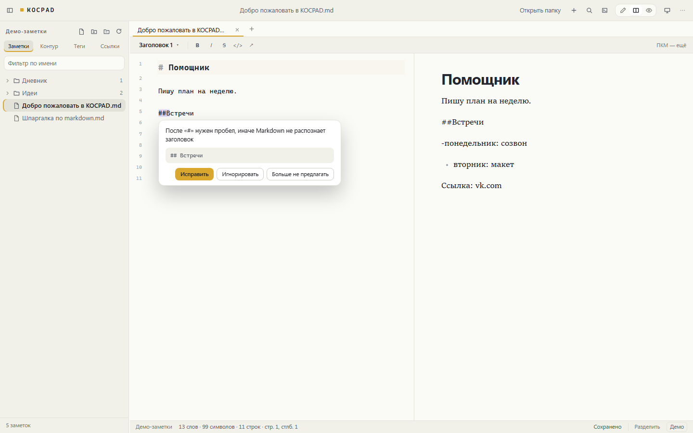
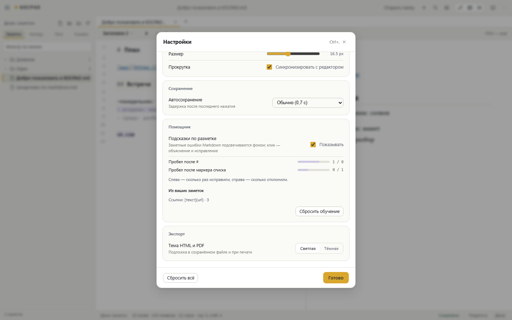

# Inline writing assistant

A small, local assistant that watches what you type and quietly highlights places
where the markdown is likely wrong or could be sharper. It is **not** a chat and
it never rewrites anything on its own: a highlight is only an invitation to look.

Status: **shipped in `1.5.1` on `main`; M3 style hints are in the beta line.**
The editor highlights likely markup
mistakes, the popover fixes them on click, and the settings panel shows what the
assistant has learned. It is still developed further on the `Experimental` branch
(M3 style hints are next); nothing reaches `main` until it is accepted there.



## Decisions

| Question | Decision |
|---|---|
| Trigger | Inline, ambient. The user does not ask for anything; the editor notices. |
| Visual | Background tint only (lavender, ~15–18% opacity), 150 ms fade-in, no underline. Subtle but visible; honours "reduce motion". |
| Fix action | Only by click on the highlight. No autofix, no hotkey in v1. |
| Scope of v1 rules | All 16 markup rules below. Style advice is a later phase. |
| Learning | Local only. The panel lives in **Settings**, shows accepted/ignored counts, per-rule confidence and learned habits, with a reset. |
| Network | None. No model download in v1; no LLM, no telemetry. |
| Branch | `Experimental` (from `beta`), CI builds it, no release tags. |

## Non-goals for v1

- No chat, no "ask AI" panel, no free-form generation.
- No style/grammar advice (long sentences, wordiness) — phase 3.
- No automatic edits.
- No model fine-tuning or per-user trained weights.
- No changes to the note format or the file layer.

## User experience

1. The user types `##Hello world`.
2. After a 300–400 ms pause the engine reports a diagnostic for `##Hello `.
3. The range gets a lavender background; nothing moves, no popup appears.
4. Clicking the tinted range opens a small anchored popover:
   - **what**: "После `##` нужен пробел, иначе Markdown не распознает заголовок";
   - **how it should look**: `## Hello world` (monospace, diff-like);
   - **buttons**: «Исправить» (applies the edit and closes), «Игнорировать» (this
     instance, remembered for the session), «Больше не предлагать» (disables the
     rule, asks nothing else).
5. At most **five** highlights are visible at once; the rest wait until the
   visible ones are resolved or the caret moves.
6. High-confidence rules appear slightly stronger; rules the user keeps ignoring
   fade out of the list (see Learning).

### Batch fixes from the context menu

Select a fragment that contains several suggestions and open the editor context
menu (ПКМ): it gains two entries.

- **«Применить все исправления (N)»** applies every fix fully inside the selection as
  one transaction, so a single `Ctrl+Z` reverts the whole batch.
- **«Отклонить подсказки (N)»** ignores those suggestions for the rest of the
  session, the same as the popover's «Игнорировать».

The count comes from the rules run over the whole document, not from the five
visible tints, so a selection can fix more suggestions than are currently shown.

Keyboard: `Esc` closes the popover; the highlight is reachable with the caret and
`Enter` opens it (the fix itself stays click/Enter on the button — no hidden
shortcut).

## Rules (16, markup only)

| ID | Rule | Example | Fix |
|---|---|---|---|
| `heading-space` | Space required after `#` | `##Hello` | `## Hello` |
| `heading-too-many` | More than six `#` | `####### x` | demote to `###### x` (or plain text) |
| `heading-skip` | Skipped heading level after a previous heading (`##` → `####`) | `#### x` after `## y` | suggest `### x` |
| `link-bare-url` | A bare URL on its own | `vk.com` | `[vk.com](https://vk.com)` |
| `link-unclosed` | Link syntax not closed | `[текст](url` | close with `)` |
| `link-no-protocol` | Destination without a scheme | `](vk.com)` | `](https://vk.com)` |
| `list-space` | No space after the list marker | `-пункт` | `- пункт` |
| `list-mixed-markers` | `-` and `*` mixed in one list | `- a` / `* b` | unify to the first marker |
| `code-fence-unclosed` | Fenced block never closed | ` ```js …` | insert closing fence at the end |
| `code-inline-unclosed` | Inline code not closed | `` `код `` | add closing backtick |
| `wikilink-unclosed` | `[[` without `]]` | `[[Заметка` | add `]]` |
| `tag-in-word` | `#tag` glued to a word | `дом#работа` | `дом #работа` |
| `structure-blank-before` | No blank line before heading/list/quote/table | text directly before `##` | insert blank line |
| `structure-double-blank` | Two or more blank lines | `a\n\n\nb` | collapse to one |
| `trailing-space` | Whitespace at end of line | `текст   ` | remove |
| `double-space` | Two spaces between words (not after punctuation) | `слово  слово` | one space |

All rules are deterministic, operate on the document text plus a little context
(previous/next line, inside code fence or not), and never fire inside fenced code
blocks (except the fence rules themselves).

## Architecture (planned modules)

```
src/lint/
├─ types.ts        Diagnostic { id, from, to, severity, message, example, fix? }
├─ rules.ts        one pure function per rule: (context) => Diagnostic[]
├─ engine.ts       run all rules over the document, dedupe, cap at 5
├─ decorations.ts  CodeMirror StateField/ViewPlugin: lavender marks + click
├─ popover.ts      anchored popover (reuses the existing dialog helpers)
└─ learning.ts     local events, confidence, learned patterns, reset
```

- CodeMirror 6 decorations, **no new dependencies**: a `StateField` maps
  diagnostics to `Decoration.mark({ class: 'cm-lint-suggestion' })`; a
  `ViewPlugin` handles clicks and opens the popover.
- The engine runs debounced (300–400 ms) and only when the assistant is enabled;
  it skips unchanged content by hashing the document text.
- Edits are applied through the editor's normal `dispatch` (one undo step), so
  `Ctrl+Z` reverts a fix.
- Settings: a new "Помощник" section inside the existing settings modal; the
  store gets a `lint` settings slice (enabled, disabled rule ids, learning logs)
  persisted next to the other settings.

## Learning model (no LLM, fully local)

Every interaction with a suggestion is recorded in `localStorage`
(`kocpad.lint.learning`):

```
{ rule, at, outcome: 'applied' | 'ignored' | 'disabled' }
```

- **Confidence** per rule: `(applied + 1) / (applied + ignored + 2)`. A rule keeps a
  neutral weight until it has at least 3 decisions, so one click cannot reorder
  everything.
- **Ordering**: the extension sorts visible diagnostics by weight before capping at
  five, so rules the user keeps accepting surface first. Ignored rules keep being
  shown (they are not silently removed); "Больше не предлагать" is the explicit way
  to disable one.
- **Learned habits** come from the active note, never from a hidden corpus: link
  style (`[text](url)` vs `<url>`), list marker, quote style and ATX headings. A
  habit is shown only after at least 3 examples.
- **Settings panel**: "Помощник" shows the toggle, the per-rule counters
  (applied / ignored) with a confidence bar, the habits found in the note, and
  "Сбросить обучение".



- «Сбросить обучение» deletes the event log, resets confidence to neutral and
  re-renders the panel.
- A weekly local summary ("`##` без пробела: было 14, стало 2") is still on the
  list; it can be derived from the same log without new storage.

## Style hints (M3)

Off by default; Settings → «Помощник» → «Стилевые подсказки».

- `style-long-sentence` — a sentence with 35+ words; informational only.
- `style-repeated-word` — «слово слово»; fixes to one word.
- `style-wordiness` — `в общем`, `на самом деле`, `как бы`, `в принципе`,
  `следует отметить`, `стоит отметить`, `по сути`, `в целом`; fixes by removing
  the phrase and its trailing comma/space.

Style rules skip fenced code, inline code and block starters (headings, lists,
quotes, tables), and never run when the toggle is off.

## Privacy

- Everything stays on the device: events and habits live in `localStorage` next to
  the existing settings; the graph/model files are not involved.
- No network calls of any kind in v1. No note text leaves the app.
- The user can disable the assistant, disable individual rules, forget the
  learning data, and exclude work by turning the toggle off.
- The assistant never sees files outside the open workspace.

## Testing

- Playwright: typing `##Hello` produces a `.cm-lint-suggestion` mark; a click opens
  the popover with the expected text; «Исправить» rewrites the line and removes the
  mark; «Игнорировать» hides it this session; disabling the assistant removes all
  marks.
- Learning panel: an applied fix increments the rule counters in settings; the reset
  button returns the panel to its empty state; habits are recognised from a note
  with three links and three list items.
- Rule correctness: a dev-only hook (`window.__kocpad.lint.diagnostics(text)`)
  returns the diagnostics array; table-driven e2e assertions for the 16 examples.
- Performance guard: typing in a 5,000-line note must not add more than one
  debounced engine run per pause (measured with a counter).
- No false positives inside fenced code blocks (one test per fence type).

The branch currently runs **70 e2e scenarios** in total (eleven of them cover the
assistant), plus typecheck, build, the Windows installers and the packaged `.exe`
smoke in CI.

## Milestones

| # | Deliverable | State |
|---|---|---|
| M1 | Rules engine + decorations + popover + «Исправить/Игнорировать» for the 16 rules | done |
| M2 | Settings section, event log, confidence, learned habits, reset | done |
| M3 | Style suggestions (long sentences, repeats, wordiness) — opt-in, off by default | done in 1.5.3-beta.6 |
| M4 | Optional tiny local model for richer explanations/rewrites | only if M1–M3 prove useful |

## Risks

- **Noise.** 16 rules can feel like a minefield; mitigation: max 5 visible, no
  auto-open, easy disable, confidence ordering.
- **False positives.** Bare URLs, `#` inside words and lists are context
  sensitive; rules must be conservative, and each gets a dedicated test.
- **Performance.** Debounced, cached by text hash, no async work in v1.
- **Scope creep.** The assistant must stay outside the core release line until it
  is accepted; it lives on `Experimental` and never touches the file layer.
