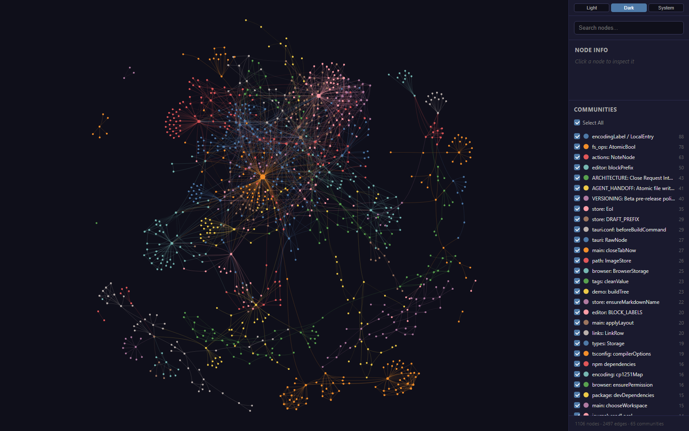

# Knowledge graph (graphify)

[graphify](https://github.com/Graphify-Labs/graphify) turns a folder into a
knowledge graph (AST for code + semantic extraction for docs), clusters it into
communities and exports HTML, JSON, an Obsidian vault and a report.

## What is installed here

- CLI: `graphify` 0.9.114 from PyPI (`graphifyy`) in `D:\ИИ 2.0\.venv-graphify`
  (kept outside the repo; recreate with the command below).
- Skill: `.agents/skills/graphify/` (project-scoped install, committed, 99 KB) so
  agents that read `.agents/` can use the `/graphify` workflow.

```powershell
python -m venv D:\ИИ 2.0\.venv-graphify
D:\ИИ 2.0\.venv-graphify\Scripts\python.exe -m pip install graphifyy
```

## What was built

Corpus: 109 files (59 code, 15 docs, 35 images; images skipped — no vision backend
in this environment).

- **Code:** 59 files through graphify's tree-sitter AST extractor → 956 nodes,
  2459 edges (imports, calls, type references).
- **Docs:** 15 markdown/HTML files extracted semantically by three agent passes
  into 150 concept nodes and ~150 edges (the schema graphify's skill expects).
- **Merged graph:** **1106 nodes, 2497 edges, 65 communities**, no import cycles.

Outputs (generated, not committed; `graphify-out/` is in `.gitignore`):

| File | What |
|---|---|
| `graphify-out/graph.html` | interactive graph: search, click nodes, filter by community |
| `graphify-out/graph.json` | persistent graph for `graphify query/path/explain` |
| `graphify-out/GRAPH_REPORT.md` | corpus check, hubs, god nodes, surprising connections, knowledge gaps, suggested questions |
| `graphify-out/obsidian/` | Obsidian vault + `graph.canvas` |



## What the graph says

God nodes (most connected abstractions):

1. `Store` — 109 edges (the state owner)
2. `AppActions` — 55
3. `MarkdownEditor` — 45
4. `h()` — 41
5. `isDraftPath()` — 39
6. `boot()` — 36
7. `Storage` — 33
8. `basename()` — 29
9. `BrowserStorage` — 28
10. `icon()` — 28

Notable inferences: external-edit detection is tied to the toast container (the
conflict dialog lives on the overlay), encoding preservation is tied to the status
bar (the encoding/EOL hint), and the formatting-entry-points decision is tied to
the format bar — i.e. the three UI surfaces the docs promise are exactly the ones
that will change next.

Suggested questions from the report:

- Why does `@tauri-apps/api` bridge `npm dependencies` to so many feature
  communities? (betweenness 0.078 — the IPC boundary)
- Why does `Store` connect encoding, drafts, tabs, links and the status bar?
  (betweenness 0.067)
- Which communities are weakly connected and may deserve splitting? The report
  flags `encodingLabel / LocalEntry` (cohesion 0.051) and `fs_ops: AtomicBool`
  (0.058) as the loosest clusters.

## Re-running

Code-only rebuild (no LLM, fast, deterministic):

```powershell
cd D:\ИИ 2.0\KOCPAD
D:\ИИ 2.0\.venv-graphify\Scripts\graphify.exe update . --no-cluster
```

Full rebuild with the semantic layer (needs an agent that can read docs and emit
the extraction JSON, or Claude Code with the installed skill):

```powershell
D:\ИИ 2.0\.venv-graphify\Scripts\graphify.exe update .   # code AST + clustering
```

The interactive graph is already generated: open
`graphify-out/graph.html` in a browser. After a big refactor, rerun the update and
open the file again — the HTML is regenerated in place.
